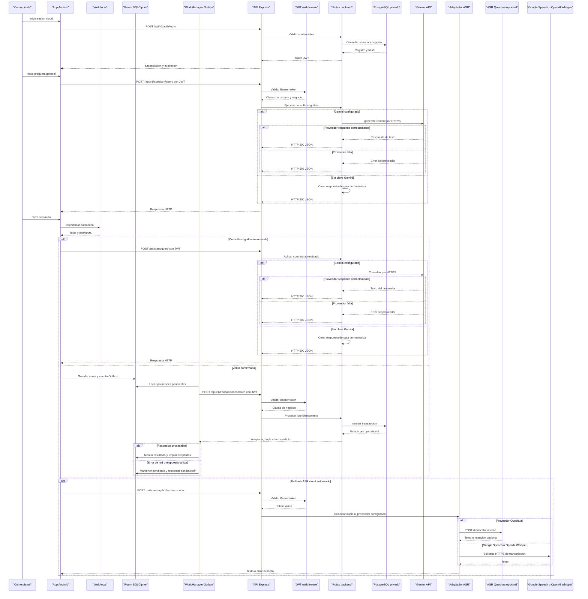

# API & Service Communication Contracts

El backend expone 20 rutas HTTP bajo `/api/v1`, con contratos JSON, carga multipart para audio y una conexión SSE para eventos. La app móvil combina peticiones síncronas con persistencia local y sincronización diferida mediante Outbox.

## Service Catalog

| Servicio | Puerto / acceso | Categoría | Propósito |
|---|---|---|---|
| Android Yapay | Cliente; no escucha en un puerto | Client | Interfaz, reconocimiento local, almacenamiento Room y sincronización |
| `backend` | 3000 en Compose; puerto asignado por Railway en nube | API Layer | API autenticada para usuarios, ventas, productos, asistentes y ASR |
| `postgres` | 5432 dentro de Compose; 5433 en el host por defecto | Infrastructure | Persistencia central PostgreSQL 16 |
| `quechua-asr` | 8000 solo en la red Compose y perfil opcional | Business / AI | Transcripción Whisper y clasificación experimental por similitud |
| Gemini API | HTTPS externo, opcional | External AI | Respuestas cognitivas invocadas por el backend cuando se configura la clave |
| Google Speech / OpenAI Whisper | HTTPS externos, opcionales | External ASR | Proveedores alternativos de transcripción |

`postgres` utiliza la imagen `postgres:16-alpine`. `backend` se construye desde `backend/Dockerfile` y depende de Express, `pg` y, de forma opcional, `@google/generative-ai`. `quechua-asr` se construye desde `quechua-asr/Dockerfile` y depende de FastAPI, PyTorch y Transformers. El servicio Quechua no se publica al host ni se inicia en el perfil Compose normal.

## API Endpoints Inventory

Los paths de la tabla son absolutos desde la raíz de la API. Salvo las rutas marcadas como públicas, requieren `Authorization: Bearer <JWT>`.

| Servicio | Método | Path | Request | Response principal / estado |
|---|---|---|---|---|
| Backend health (público) | GET | `/api/v1/health` | Sin body | `{status, service, database}`; 200 conectado, 503 degradado |
| Auth (público) | POST | `/api/v1/auth/login` | `LoginRequest` | `{accessToken, tokenType, expiresIn}`; 200, 400, 401 |
| Auth (público) | POST | `/api/v1/auth/register` | `RegisterRequest` | Mismo token; 201, 400, 409 |
| Auth | PUT | `/api/v1/auth/business` | `BusinessProfileRequest` | Sin body; 204, 400, 401, 404 |
| Auth | POST | `/api/v1/auth/change-password` | Objeto de contraseña actual/nueva | Sin body; 204, 400, 401 |
| ASR | POST | `/api/v1/asr/transcribe` | `multipart/form-data`, campo `audio` | `{texto, simulada}` o clasificación; 200, 400, 401, 413, 500, 503 |
| Actualizaciones Android (público) | GET | `/api/v1/app-updates/latest` | Sin body | `{versionCode, versionName, url, sha256, size}`; 200 o 404 |
| Actualizaciones Android (público) | GET | `/api/v1/app-updates/apk` | Sin body | APK `application/vnd.android.package-archive`; 200 o 404 |
| Assistant | POST | `/api/v1/assistant/query` | `AssistantQueryRequest` | `{respuesta}`; 200, 400, 401, 502 |
| Learning | POST | `/api/v1/learning/feedback` | `LearningFeedbackRequest` | `{accepted}`; 200, 400, 401, 500 |
| Voice logs | POST | `/api/v1/logs/comandos` | Registro de comando de voz | `{accepted}`; 201 nuevo, 200 duplicado, 400, 401, 500 |
| Cloud invoices | POST | `/api/v1/facturas` | `{customerName?, items: InvoiceItem[]}` | `{id, invoiceNumber, total, createdAt, pdfBase64, pdfSimulated}`; 201, 400, 401, 500 |
| Cloud payment QR | POST | `/api/v1/qr` | `{qrBase64}` | `{message}`; 200, 400, 401, 500 |
| Cloud events | GET | `/api/v1/sync/updates` | Sin body | `text/event-stream`; 200 y eventos SSE, 401 |
| Products | GET | `/api/v1/products?limit&offset` | Query params opcionales | `{items, pagination}`; 200, 400, 401 |
| Products | POST | `/api/v1/products` | `{name, unit, salePrice}` | Producto creado; 201, 400, 401, 409 |
| Products | PUT | `/api/v1/products/:id` | `{name, unit, salePrice}` | Producto actualizado; 200, 400, 401, 404 |
| Products | DELETE | `/api/v1/products/:id` | ID de path | Sin body; 204, 401, 404 |
| Product sync | GET | `/api/v1/products/sync?desde&cursorActualizadoEn&cursorId` | Query de cursor | `{items, total, timestamp}`; 200, 400, 401, 500 |
| Transaction sync | POST | `/api/v1/transacciones/batch` | `SyncBatchRequest` | `SyncBatchResponse`; 200, 400, 401, 500 |

Las rutas de registro/inicio de sesión, health y descarga de actualizaciones son públicas. El resto requiere JWT. El catálogo del backend incluye CRUD de productos, facturas, QR y SSE, pero la app Retrofit actual no tiene un cliente para todos esos contratos; ver [Conexión Android ↔ Backend](../../../../../defensa_tecnica/06_mapa_tecnico_apis_conexiones_ia.md).

## Management & Observability Endpoints

| Servicio | Endpoint | Métricas personalizadas |
|---|---|---|
| Backend | `GET /api/v1/health` | Ninguna; consulta `SELECT 1` a PostgreSQL |
| Quechua ASR opcional | `GET /health` | Ninguna; responde cuando el modelo ASR ya cargó |

No se encontró exposición de Prometheus, OpenTelemetry, Swagger/OpenAPI, GraphQL ni protobuf en el código examinado.

## DTOs & Contracts

- **Android Auth:** `LoginRequest`, `LoginResponse`, `RegisterRequest`, `RegisterResponse`, `BusinessProfileRequest`.
- **Android assistant/learning:** `AssistantQueryRequest`, `AssistantQueryResponse`, `VoiceCorrection`, `LearningFeedbackRequest`, `LearningFeedbackResponse`.
- **Android synchronization:** `SyncBatchRequest`, `TransaccionEntrante`, `TransaccionPayload`, `SyncBatchResponse`, `ResultadoOperacion`, `ProductSyncResponse`, `ProductSyncItem`.
- **Other Android APIs:** `CloudAsrResponse`, `AppUpdateInfo`.
- **Backend synchronization:** `SyncBatchRequest`, `TransaccionEntrante`, `TransaccionPayload`, `ResultadoPorOperacion`.
- **Inline backend contracts:** `InvoiceItem` and request/response shapes are validated and created directly in route handlers; there is no separate generated OpenAPI contract.

Kotlin DTOs son `data class` con propiedades `val`; las interfaces TypeScript se verifican durante compilación, no existen como clases en runtime. Retrofit serializa con Gson; Express analiza JSON con su middleware y responde JSON. La carga de audio usa multipart y los eventos se envían como SSE.

## Communication Patterns

- **Android → Backend:** REST síncrono a `BuildConfig.API_BASE_URL`; Retrofit/OkHttp usa Bearer JWT en operaciones autenticadas. Timeout general móvil: conexión 15 s, lectura/escritura 30 s. ASR cloud usa hasta 125 s.
- **Android offline → nube:** `Room` conserva transacciones/pendientes; `WorkManager` requiere conectividad y reintenta con backoff exponencial desde 30 s. El lote identifica cada operación para deduplicación; no hay broker de mensajes.
- **Backend → PostgreSQL:** pool `pg.Pool` de hasta 5 conexiones, conexión inicial con timeout 5 s; en producción TLS tiene `rejectUnauthorized: true` y puede recibir CA privada mediante `DATABASE_SSL_CA`.
- **Backend → Gemini:** llamada HTTPS síncrona desde el servicio assistant, solo si `GEMINI_API_KEY` está configurada; timeout 15 s. La key queda en el backend. No se envían ventas ni inventario al modelo desde este contrato. Sin key se conserva la guía demostrativa; error del proveedor da 502.
- **Backend → ASR:** Google Speech y OpenAI Whisper son opciones externas. El proveedor `quechua` reenvía multipart al servicio interno; el perfil Compose permite HTTP en red privada, no publica el puerto 8000 al host. El proveedor `simulated` no transcribe.
- **Backend SSE:** `cloud-events.ts` publica eventos de productos/facturas/QR en memoria del proceso. No es una cola durable ni tiene replay. El código Android actual no declara un cliente Retrofit SSE.
- **Resiliencia:** no se encontró Circuit Breaker en backend. Hay reintentos del Outbox via WorkManager; las llamadas HTTP del asistente y actualización no tienen una política de retry propia. Compose usa DNS de servicio (`postgres`, `quechua-asr`), no service registry.
- **Entrada única:** Express monta rutas bajo `/api/v1`; no hay gateway independiente. Docker Compose espera a PostgreSQL saludable antes de iniciar Backend; el Dockerfile ejecuta migraciones y `server.ts` consulta PostgreSQL antes de escuchar.
- **Seguridad de transporte:** Railway publica la API por HTTPS; Postgres Railway permanece privado con validación TLS estricta. HTTP solo se usa en desarrollo local/debug o entre servicios privados autorizados. No se usa OAuth2; las rutas privadas usan JWT Bearer.

## Service Technology Matrix

| Servicio | Web | Data access | Discovery | Gateway | Health | Cache | Metrics |
|---|---|---|---|---|---|---|---|
| Android | Jetpack Compose | Room + SQLCipher | URL de build / host explícito | Cliente Retrofit | No aplica | No response cache | No |
| Backend | Express 5 | `pg` Pool | DNS Compose / URL configurada | Router `/api/v1` | `/api/v1/health` | Sin cache HTTP | No |
| PostgreSQL | Protocolo PostgreSQL | Motor relacional | Nombre `postgres` en Compose | No | `pg_isready` en Compose | No | No |
| Quechua ASR opcional | FastAPI | Pesos en volumen HF | Host privado configurado | No | `/health` | Cache de pesos HF | No |
| Gemini / ASR externos | API HTTPS | Gestionado por proveedor | URL del proveedor | No | Externo | Externo | Externo |

## Service Communication Sequence

<!-- mermaid-checked: every participant uses `participant Id as "Label"`, no \n in aliases/messages/notes, every alt/opt/loop closed by end, no `:` inside any alias -->

