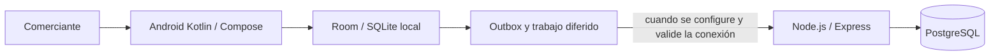

# Asistente conversacional offline para MYPES de Vinto

Prototipo de asistente configurable por rubro para registrar ventas y consultar el saldo local de existencias en MYPES del centro de Vinto, Cochabamba. Universidad Adventista de Bolivia, Carrera de Ingeniería en Sistemas.

El proyecto busca guardar primero en el teléfono y funcionar sin red durante la atención. No es un sistema completo de almacén: compras a proveedores, lotes, costos, facturación, cobro QR y otros módulos están fuera del alcance vigente.

> **Perfil de Investigación:** es un documento académico aparte (Trabajo de Grado / INV-645). **No se versiona en este repositorio.** El alcance técnico de este repo se describe en `docs/01_Proyecto_y_Alcance.md` y en la matriz de cumplimiento.

## Estado del repositorio

Corte documental: rama `docs/arq-tec-cumplimiento-sin-perfil` (sobre main). Enfoque: cumplir criterios de **Arquitectura de Software (ARQ-643)** y **Tecnologías en Internet (TEC-644)** con evidencia en código y documentación técnica.

- El backend es Node.js, TypeScript, Express y PostgreSQL. Su README describe login de propietario, catálogo protegido y recepción idempotente de lotes; el servicio está pensado para pruebas locales.
- El módulo Android está en `mobile/`: Kotlin, Jetpack Compose y persistencia local con Room. Incluye login local con PIN, onboarding, dashboard, inventario y componentes de PLN/voz.
- El usuario reportó instalación en un Motorola G60 y guardado de un producto de prueba. Esa prueba debe archivarse en `evidence/` con pasos, fecha, entorno y commit para que sea repetible.
- El código móvil también contiene modelos de venta, outbox, WorkManager y cliente Retrofit. La integración completa móvil–API, especialmente desde un teléfono físico, todavía debe probarse. El cliente usa `10.0.2.2` (emulador) y el PIN local no equivale al token del backend.
- No hay opción de interfaz para eliminar productos en la pantalla de inventario revisada. No afirmar que esa función está implementada.
- El modelo Vosk no se versiona en Git. El reconocimiento debe probarse después de instalar localmente el modelo requerido.
- La rama contiene código fuente, no un APK de distribución publicado. Una instalación local exitosa no certifica todas las funciones.

Consulta el estado, los criterios por materia y las brechas en la [Matriz de cumplimiento y evidencias](docs/13_Matriz_Cumplimiento_Tres_Materias_2026-2.md).

## Justificación del stack (ARQ + TEC)

| Capa | Tecnología | Criterio que cubre |
|---|---|---|
| Backend | Node.js 24 + TypeScript + Express | APIs RESTful, asincronía y backend de TEC-644 |
| Persistencia central | PostgreSQL + migraciones SQL | Relaciones, restricciones y transacciones del dominio (negocios, productos, operaciones) |
| Cliente | Android Kotlin + Jetpack Compose | UI nativa y operación offline |
| Persistencia local | Room / SQLite | Offline-first; fuente de verdad en el dispositivo |
| Contenedores locales | Docker Compose | Entorno reproducible de desarrollo (no equivale a despliegue cloud) |

**MongoDB/Mongoose y front-end web (HTML/CSS/JS)** aparecen en el sílabo de TEC-644. PostgreSQL y Compose **no** los sustituyen. Antes de la defensa, confirmar con el docente si se demuestran en prácticas separadas o se exige cambio de alcance. Ver [plan de segunda entrega](docs/14_Segunda_Entrega_Tareas_por_Materia.md).

## Arquitectura resumida



Este dibujo resume la arquitectura **prevista y parcialmente implementada**; no prueba que todos los enlaces estén conectados en el dispositivo. El SAD 1.1 conserva una entrega anterior con Spring Boot. La arquitectura vigente se documenta con el código Node.js y se debe emitir un SAD v2 coherente (ver `docs/03_SAD_Arquitectura.md`).

## Inicio local del backend

Hace falta Node.js 24, npm y Docker Desktop con Compose. Desde la raíz del repositorio:

```powershell
docker compose up -d postgres
Copy-Item backend/.env.example backend/.env
Set-Location backend
npm ci
npm run db:migrate
npm run dev
```

La comprobación de salud local está en http://127.0.0.1:3000/api/v1/health. Para login y catálogo, sigue el [README del backend](backend/README.md). No publiques `backend/.env` ni uses datos reales.

Para compilar e instalar Android, abre `mobile/` en Android Studio, sincroniza Gradle, selecciona el teléfono/emulador y ejecuta la variante debug. La sincronización hacia la API debe tratarse como una prueba aparte.

## Documentos (técnicos y de evaluación)

| Documento | Propósito |
|---|---|
| [Matriz de cumplimiento](docs/13_Matriz_Cumplimiento_Tres_Materias_2026-2.md) | Criterios de ARQ-643, TEC-644 e INV-645, estados y evidencias |
| [Mapa del trabajo](docs/MAPA_PRESENTACION.md) | Relación del proyecto con las tres materias |
| [Proyecto y alcance](docs/01_Proyecto_y_Alcance.md) | Alcance vigente y exclusiones |
| [Requisitos y UX/UI](docs/02_Requisitos_y_UX.md) | Requisitos y diseño |
| [SAD](docs/03_SAD_Arquitectura.md) | SAD 1.1 entregado + nota de estado; base para SAD v2 |
| [Plan segunda entrega](docs/14_Segunda_Entrega_Tareas_por_Materia.md) | Tareas por materia y justificación de stack |
| [Backend](backend/README.md) | Inicio local, autenticación, catálogo y API |
| [Android](mobile/README.md) | Módulo móvil y estado de integración |
| [Diagramas](diagrams/README.md) | Fuentes C4, casos de uso y coherencia |
| [Evidencias](evidence/README.md) | Cómo registrar pruebas revisables |

Los borradores sustituidos están en `docs/archive/`. No reemplazan las versiones vigentes.

## Equipo

Eva Lizeth Chino Quispe, Christian Gonzales Mamani, Marializ Mamani Quispe, Kevin Jhonathan Rocha Rojas y Luis Gerardo Lazo Bustamante.

## Diseño

- [Prototipo en Figma](https://snake-dijon-92194767.figma.site/)
- [Sistema de diseño](https://www.figma.com/make/jr73cU7am5OisMNhkgxkkr/Sistema-de-Dise%C3%B1o-MYPES-Vinto?p=f&fullscreen=1)

Figma muestra una propuesta de interfaz; no reemplaza la aplicación ni una prueba de funcionamiento.
