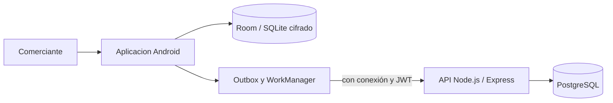

# Asistente conversacional offline para MYPES de Vinto

**Proyecto integrador · Ingeniería en Sistemas · Universidad Adventista de Bolivia**

Prototipo móvil local-first para registrar ventas y consultar existencias en micro y pequeñas empresas de Vinto, Cochabamba. La información de operación se conserva primero en el teléfono; la sincronización con el servidor ocurre después, cuando hay conexión y una cuenta API vinculada.

> **Corte documental:** 13 de noviembre de 2026 · revisión base `03afcbd` · rama local `feature/update-doc`. Esta copia de documentación no se ha publicado.

## En pocas palabras

- **Aplicación:** Android nativo con Kotlin y Jetpack Compose.
- **Datos locales:** Room/SQLite con SQLCipher; esquema Room versión 6.
- **Servidor:** Node.js 24, TypeScript, Express y PostgreSQL.
- **Asistencia por voz:** Vosk más extracción y clasificación basadas en reglas Kotlin. Yapay es demostrativo y solicita confirmación; no es un LLM.
- **Estado de validación:** CI del backend aprobado para la revisión indicada; pruebas Android en dispositivo y sincronización integral teléfono–API todavía requieren evidencia.

## Qué permite el prototipo

La aplicación incluye acceso local mediante identificador y PIN, configuración inicial del negocio, inventario local, ventas, consulta de fiados, reportes y asistencia de voz. El PIN local es distinto de la autenticación remota: la API usa correo, contraseña y JWT.

El backend ofrece registro e inicio de sesión, catálogo por negocio, recepción idempotente de eventos, y endpoints de factura simulada, QR y SSE. La API no mantiene un saldo remoto completo de ventas fiadas. Los productos creados solo en el teléfono tampoco se cargan automáticamente al catálogo remoto.

La factura PDF es de demostración, no fiscal; no existe integración con el SIN. La voz depende de instalar el modelo Vosk. La presencia de una pantalla o endpoint en el código no demuestra por sí sola que el flujo completo haya sido probado.

## Arquitectura



La base local conserva las operaciones del teléfono. PostgreSQL gestiona cuentas, negocios, catálogo y recepción de eventos de sincronización. Para componentes, límites y flujos, consulta [Arquitectura actual](docs/02_Arquitectura_SAD.md).

## Decisiones tecnológicas y alcance académico

PostgreSQL responde al modelo actual de propietarios, negocios, productos y operaciones relacionadas: el esquema existente usa migraciones SQL, relaciones, restricciones únicas y transacciones. Room/SQLite cubre el almacenamiento local necesario para operar sin conexión. Incorporar MongoDB/Mongoose para duplicar los mismos datos añadiría sincronización y mantenimiento sin una necesidad funcional identificada; no se sostiene esta decisión afirmando que MongoDB carezca de transacciones.

La segunda entrega también solicita evidencias de MongoDB/Mongoose y una aplicación web. Este repositorio usa PostgreSQL y Android, que **no son equivalentes** a esos requisitos. La pertinencia de una demostración NoSQL separada o de una ampliación web debe confirmarse con la docente antes de afirmar cumplimiento. La explicación completa está en el [informe técnico](docs/Informe_Segunda_Entrega_TI.md).

## Inicio local del backend

Hace falta Node.js 24, npm y Docker Desktop con Compose. Desde la raíz del repositorio:

```powershell
docker compose up -d postgres
Copy-Item backend/.env.example backend/.env
$secret = node -e "process.stdout.write(require('node:crypto').randomBytes(32).toString('base64url'))"
(Get-Content backend/.env) -replace '^JWT_SECRET=.*$', "JWT_SECRET=$secret" | Set-Content -Encoding ascii backend/.env
Set-Location backend
npm ci
npm run db:migrate
npm run admin:create-owner -- "MYPE de prueba" "propietario@example.test"
npm run dev
```

El alta genera una contraseña temporal para uso local; consérvala en privado y cámbiala según el [README del backend](backend/README.md). Comprueba la salud en http://127.0.0.1:3000/api/v1/health. No publiques `backend/.env` ni uses datos reales.

Para compilar e instalar Android, abre mobile/ en Android Studio, sincroniza Gradle, selecciona el teléfono/emulador y ejecuta la variante debug. La sincronización hacia la API debe tratarse como una prueba aparte.

## Documentos

| Documento | Propósito |
|---|---|
| [Índice documental](docs/00_Indice.md) | Documentos vigentes, documentos académicos y archivos históricos |
| [Proyecto y alcance](docs/01_Proyecto_y_Alcance.md) | Alcance vigente y exclusiones |
| [Requisitos y UX/UI](docs/02_Requisitos_y_UX.md) | Línea base académica y nota de implementación |
| [Arquitectura actual](docs/02_Arquitectura_SAD.md) | Componentes implementados y límites verificados |
| [Manual de usuario](docs/03_Manual_de_Usuario.md) | Flujos disponibles y precauciones de uso |
| [Plan de pruebas](docs/04_Plan_de_Pruebas.md) | Casos funcionales y automatizados |
| [Resultados](docs/05_Resultados_de_Pruebas.md) | Bitácora de ejecuciones confirmadas |
| [Guía de ejecución](docs/06_Guia_de_Despliegue.md) | Instalación y configuración local paso a paso |
| [CI/CD](docs/07_CI_CD_Report.md) | Ejecuciones reales de GitHub Actions |
| [SAD académico](docs/03_SAD_Arquitectura.md) | SAD 1.1 histórico, con las decisiones originales |
| [Informe de Segunda Entrega - TI](docs/Informe_Segunda_Entrega_TI.md) | Informe técnico de alcance, requisitos, arquitectura, persistencia y API |
| [Backend](backend/README.md) | Inicio local, autenticación, catálogo y API |
| [Android](mobile/README.md) | Módulo móvil y estado de integración |
| [Diagramas](diagrams/README.md) | Fuentes C4, casos de uso y coherencia pendiente |
| [Evidencias](evidence/README.md) | Cómo registrar pruebas revisables |

Los borradores sustituidos están en docs/archive/. No reemplazan las versiones vigentes ni deben presentarse sin revisar su estado.

## Equipo

Eva Lizeth Chino Quispe, Christian Gonzales Mamani, Marializ Mamani Quispe, Kevin Jhonathan Rocha Rojas y Luis Gerardo Lazo Bustamante.

## Diseño

- [Figma vigente del proyecto](https://www.figma.com/make/detrwbrxCanqoPjHb9TjwX/Mockup-Improvement-Request--Community---copia---copia-?p=f&t=qANDWN72XqQ9Pt4y-0)

Figma es la referencia visual vigente; no reemplaza la aplicación Android, no demuestra que cada pantalla esté implementada y no constituye una prueba funcional.
