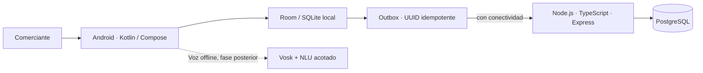

# Asistente conversacional offline para MYPES de Vinto

Proyecto integrador de Ingeniería en Sistemas — Universidad Adventista de Bolivia — Gestión 2026-2.

## Estado del repositorio

El repositorio está preparado como base de trabajo académico y de implementación. El backend ahora usa Node.js/TypeScript/Express y PostgreSQL para el esqueleto inicial, la conexión a la base y `GET /api/v1/health`; incluye el esquema relacional inicial de negocios/productos/operaciones. **Aún no contiene autenticación, autorización, CRUD comercial, ventas, endpoint de sincronización ni app Android funcional verificada.** La configuración actual se limita a desarrollo local y no debe exponerse a Internet ni usarse con datos reales.

## Arquitectura acordada por el equipo



**Línea base unificada solicitada:** Kotlin + Jetpack Compose; Room/SQLite local; API Node.js + TypeScript + Express; PostgreSQL remoto como fuente autoritativa comercial; Outbox + WorkManager + UUID para sincronización idempotente. El Perfil/SAD entregado anteriormente menciona Spring Boot/PostgreSQL; la transición a Node requiere ADR sucesora y actualización del SAD/diagramas. El sílabo de Tecnologías en Internet incluye MongoDB/Mongoose y producto web full-stack: la líder debe confirmar con el docente si MongoDB debe aparecer en el producto o puede demostrarse en una práctica acotada y si se exige cliente web además de Android. PostgreSQL no se presenta como NoSQL.

## Empezar localmente

Requisitos: Node.js 24.x, npm y Docker Desktop.

1. Desde la raíz del repositorio, iniciar la base de desarrollo:

   ```powershell
   docker compose up -d postgres
   ```

   Espera hasta que `docker compose ps` muestre PostgreSQL como `healthy`.

2. Copiar configuración de ejemplo y ejecutar la API:

   ```powershell
   Copy-Item backend/.env.example backend/.env
   Set-Location backend
   npm install
   npm run dev
   ```

3. Abrir `http://127.0.0.1:3000/api/v1/health`. La respuesta debe indicar que PostgreSQL está conectado.

La migración inicial se monta para la inicialización de un volumen vacío; Docker no vuelve a ejecutar scripts de `docker-entrypoint-initdb.d` en una base ya creada. No elimines volúmenes con datos para “arreglar” una migración. Define y documenta una herramienta de migración antes de desarrollar el esquema compartido.

## Documentos activos

Los documentos vigentes se numeran desde 01 y se navegan desde [`00_Indice.md`](00_Indice.md). `docs/archive/` contiene copias históricas o duplicadas y no es fuente activa.

| N.º | Documento | Para qué sirve |
|---|---|---|
| 01 | [Proyecto y alcance](docs/01_Proyecto_y_Alcance.md) | Problema, MVP, límites y fuentes |
| 02 | [Requisitos y UX](docs/02_Requisitos_y_UX.md) | Requisitos, casos de uso y experiencia |
| 03 | [SAD de Arquitectura](docs/03_SAD_Arquitectura.md) | SAD v1.1 entregado y nota de cambio objetivo |
| 04 | [Decisión de stack](docs/04_Decisiones_Stack.md) | Línea Node/PostgreSQL y consultas docentes |
| 05 | [Matriz de trazabilidad](docs/05_Matriz_Trazabilidad.md) | Relación requisitos, casos y evidencia |
| 06 | [Auditoría de rúbricas](docs/06_Auditoria_Rubricas.md) | Brechas y verificación académica |
| 07 | [Cronograma y riesgos](docs/07_Cronograma_y_Riesgos.md) | Hitos, fechas, R3 y R6 |
| 08 | [Guía de entrega](docs/08_Guia_Entrega.md) | Revisión previa a presentar |
| 09 | [Registro de evidencias](docs/09_Evidencias.md) | Estado y ubicación de artefactos |
| 10 | [Plan de implementación y API](docs/10_Plan_Implementacion_y_API.md) | Orden de desarrollo y contrato inicial |
| 11 | [Matriz de tres materias](docs/11_Matriz_Rubricas_Tres_Materias.md) | Criterios, estados y evidencias |
| — | [Product Backlog y equipo](docs/Backlog_y_Equipo.md) | Épicas, responsables y aceptación de tareas |

## Próximo incremento del equipo

1. Eva consulta y archiva las respuestas docentes sobre Node/PostgreSQL, Mongo/Mongoose, frontend web y fecha exacta de defensa.
2. Marializ documenta herramienta de migraciones y completa catálogo con autorización por negocio antes de exponerlo.
3. Kevin define el flujo móvil de catálogo/venta, modo avión y confirmación; construir frontend web solo si TI confirma que lo exige.
4. Christian prepara casos de intención en texto; integrar Vosk después de probar venta manual offline.
5. Luis actualiza ADR/C4, vincula requisitos a pruebas y coordina revisión del recorrido vertical.
6. Eva mantiene tablero, cronograma y checklist de rúbricas; no marca completado sin evidencia.

El recorrido prioritario es **producto → venta local → modo avión → persistencia tras reinicio → API → PostgreSQL → reintento con el mismo UUID sin duplicado**. No se empieza por Gemma, microservicios o funciones fiscales.

## Fechas principales reportadas

Fechas de los documentos compartidos; confirmar en aula virtual antes de entregar:

| Fecha | Hito reportado |
|---|---|
| 14/10/2026 | Examen práctico REST y NoSQL — Tecnologías en Internet |
| 19/10/2026 | Examen integrador — Arquitectura |
| 22/10/2026 | Evaluación del Perfil — Investigación I |
| 11/11/2026 | Backend/integración — Tecnologías en Internet |
| 16/11/2026 | SAD/solución arquitectónica — Arquitectura |
| 23/11/2026 | Defensa final — Arquitectura |
| 25/11/2026 | Plataforma full-stack — Tecnologías en Internet |
| 24–26/11 y 01–03/12 | Defensa del Perfil reportada; falta confirmar fecha exacta |

El Gantt etiqueta por error el corte 29/09 como lunes. **29/09/2026 es martes; W11 va de 28/09 a 04/10.** Ver [cronograma](docs/07_Cronograma_y_Riesgos.md). El Perfil usa cinco fases; SAD/Gantt seis; el documento de cronograma explica la equivalencia sin cambiar en silencio los originales.

## Equipo

- **Eva Lizeth Chino Quispe:** líder, requisitos, coordinación y QA documental.
- **Christian Gonzales Mamani:** IA y pipeline conversacional.
- **Marializ Mamani Quispe:** backend, seguridad y persistencia.
- **Kevin Jhonathan Rocha Rojas:** UX/UI y prototipado.
- **Luis Gerardo Lazo Bustamante:** arquitectura C4, trazabilidad y QA técnico.

## Diseño

- [Prototipo navegable en Figma](https://snake-dijon-92194767.figma.site/)
- [Sistema de diseño](https://www.figma.com/make/jr73cU7am5OisMNhkgxkkr/Sistema-de-Dise%C3%B1o-MYPES-Vinto?p=f&fullscreen=1)

## Reglas para colaborar

- No subir `.env`, tokens, contraseñas, datos reales ni audio identificable.
- Crear ramas pequeñas y pedir revisión antes de integrar cambios a `main`.
- Registrar decisiones que afecten stack, datos, sincronización o alcance mediante ADR.
- Mantener README, código, SAD y diagramas coherentes con la versión realmente construida.
- Separar **propuesto**, **diseñado**, **implementado**, **probado** y **evaluado**.
- El índice de lectura está en `00_Indice.md`; las tareas ejecutables están centralizadas en `docs/Backlog_y_Equipo.md`.
