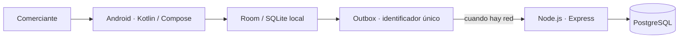

# Asistente conversacional offline para MYPES de Vinto

Prototipo para anotar una venta y consultar el saldo que queda en el teléfono, sin depender de internet en el momento de la atención. Universidad Adventista de Bolivia, Carrera de Ingeniería en Sistemas.

No es un sistema de almacén. No lleva compras, proveedores, lotes, costos ni facturación.

## De qué se trata

El comerciante elige el tipo de negocio, carga sus productos y registra la operación en el celular. El saldo se guarda en ese mismo dispositivo. Cuando hay red, la operación puede subir a la API. Si se reintenta, no se duplica.

La voz y el texto en quechua entran después de que ese recorrido ya guarde y se pueda reabrir.

## Qué hay hoy en el repositorio

La API está en Node.js, TypeScript, Express y PostgreSQL. Permite crear un propietario, iniciar sesión y consultar o dar de alta productos de un negocio.

Todavía no hay aplicación Android. Tampoco está el registro de la venta, el descuento del saldo ni la cola que espera a la red.

## Cómo está armado



El teléfono guarda primero. PostgreSQL guarda la copia remota. El documento de arquitectura v1.1 hablaba de Spring Boot; esa versión queda como antecedente. El código de esta rama usa Node.js.

## Cómo levantarlo en local

Hace falta Node.js 24, npm y Docker.

```powershell
docker compose up -d postgres
Copy-Item backend/.env.example backend/.env
Set-Location backend
npm ci
npm run db:migrate
npm run dev
```

La comprobación está en `http://127.0.0.1:3000/api/v1/health`. No se sube `backend/.env`.

## Dónde leer

| Documento | Qué es |
|---|---|
| [Mapa](docs/MAPA_PRESENTACION.md) | Cómo se reparte el trabajo entre las tres materias |
| [Perfil](docs/perfil/Perfil_final.md) | Texto de Investigación I |
| [Alcance](docs/01_Proyecto_y_Alcance.md) | Qué entra y qué queda fuera |
| [Requisitos](docs/02_Requisitos_y_UX.md) | Casos y experiencia de uso |
| [Arquitectura](docs/03_SAD_Arquitectura.md) | SAD v1.1, con la nota del cambio a Node |
| [Cronograma](docs/Cronograma_final.md) | Calendario del trabajo de grado |
| [Diagramas](diagrams/README.md) | Contexto y contenedores |

Los borradores anteriores están en [docs/archive/](docs/archive/README.md). No forman parte de la versión vigente.

## Equipo

Eva Lizeth Chino Quispe, Christian Gonzales Mamani, Marializ Mamani Quispe, Kevin Jhonathan Rocha Rojas y Luis Gerardo Lazo Bustamante.

## Diseño

- [Prototipo en Figma](https://snake-dijon-92194767.figma.site/)
- [Sistema de diseño](https://www.figma.com/make/jr73cU7am5OisMNhkgxkkr/Sistema-de-Dise%C3%B1o-MYPES-Vinto?p=f&fullscreen=1)

El prototipo de Figma muestra las pantallas. No reemplaza la aplicación.
