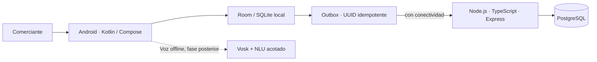

# Asistente conversacional offline para MYPES de Vinto

Prototipo para registrar ventas y consultar el saldo local de existencias, sin conexión en el momento de la atención. Universidad Adventista de Bolivia, Ingeniería en Sistemas, gestión 2026-2.

El trabajo no es un sistema de almacén: no lleva compras, proveedores, lotes, costos ni facturación. El perfil que se defiende está en [docs/perfil/Perfil_final.md](docs/perfil/Perfil_final.md). El calendario vigente está en [docs/Cronograma_final.md](docs/Cronograma_final.md).

## Estado del repositorio

Hay una API local en Node.js, TypeScript, Express y PostgreSQL. Tiene migraciones, alta de un propietario, inicio de sesión y alta y consulta de productos de un solo negocio.

Todavía no hay aplicación Android. Tampoco está el registro de la venta, el descuento del saldo ni el envío de la cola local. No se presenta este repositorio como un prototipo usable por un comerciante.

La voz queda para cuando el registro por pantalla se guarde sin red y siga ahí al reabrir la aplicación. No debe exponerse a Internet ni usarse con datos reales hasta completar controles y revisión de seguridad.

## Arquitectura acordada por el equipo



**Línea base unificada solicitada:** Kotlin + Jetpack Compose; Room/SQLite local; API Node.js + TypeScript + Express; PostgreSQL remoto como fuente autoritativa comercial; Outbox + WorkManager + UUID para sincronización idempotente. El docente confirmó que Node.js y PostgreSQL son obligatorios; falta registrar la respuesta con asignatura/docente y fecha. El Perfil/SAD entregado anteriormente menciona Spring Boot/PostgreSQL; la transición a Node requiere ADR sucesora y actualización del SAD/diagramas. El sílabo de Tecnologías en Internet incluye MongoDB/Mongoose y producto web full-stack: la líder debe confirmar si MongoDB debe aparecer en el producto o puede demostrarse en una práctica acotada y si se exige cliente web además de Android. PostgreSQL no se presenta como NoSQL.

## Empezar localmente

Requisitos: Node.js 24.x, npm y Docker Desktop.

1. Desde la raíz del repositorio, iniciar la base de desarrollo:

   ```powershell
   docker compose up -d postgres
   ```

   Espera hasta que `docker compose ps` muestre PostgreSQL como `healthy`.

2. Copiar configuración de ejemplo, crear una clave JWT local y aplicar las migraciones:

   ```powershell
   Copy-Item backend/.env.example backend/.env
   $secret = node -e "process.stdout.write(require('node:crypto').randomBytes(32).toString('base64url'))"
   Add-Content backend/.env "JWT_SECRET=$secret"
   Set-Location backend
   npm ci
   npm run db:migrate
   ```

3. Crear el primer propietario con un negocio de prueba. El comando genera una contraseña temporal y la muestra una sola vez:

   ```powershell
   npm run admin:create-owner -- "MYPE de prueba" "propietario@example.test"
   ```

4. Ejecutar la API:

   ```powershell
   npm run dev
   ```

5. Abrir `http://127.0.0.1:3000/api/v1/health`. La respuesta debe indicar que PostgreSQL está conectado. `npm run build` y `npm test` verifican el backend sin necesitar una base de datos.

No publiques el archivo `backend/.env` ni compartas la contraseña temporal generada. Las migraciones se aplican sin borrar volúmenes ni datos.

## Documentos activos

Los documentos vigentes se numeran desde 01 y se navegan desde [`00_Indice.md`](00_Indice.md). `docs/archive/` contiene copias históricas o duplicadas y no es fuente activa.

| N.º | Documento | Para qué sirve |
|---|---|---|
| — | [Perfil final](docs/perfil/Perfil_final.md) | Texto que se presenta en Investigación I |
| — | [Cronograma final](docs/Cronograma_final.md) | 26 semanas del Trabajo de Grado y las fechas de este semestre |
| — | [Nota de nombre](docs/Nota_de_nombre.md) | El sistema no se llama gestión de ventas e inventario |
| — | [Guía de la próxima semana](docs/Guia_proxima_semana.md) | Qué tocar en GitHub y qué llevar a cada materia |
| 01 | [Proyecto y alcance](docs/01_Proyecto_y_Alcance.md) | Problema, recorrido mínimo y límites |
| 02 | [Requisitos y UX](docs/02_Requisitos_y_UX.md) | Requisitos, casos de uso y experiencia |
| 03 | [SAD de Arquitectura](docs/03_SAD_Arquitectura.md) | SAD v1.1 entregado y nota de cambio objetivo |
| 04 | [Decisión de stack](docs/04_Decisiones_Stack.md) | Línea Node/PostgreSQL y consultas docentes |
| 05 | [Product Backlog y equipo](docs/05_Product_Backlog_y_Equipo.md) | Épicas, responsables y aceptación de tareas |
| 06 | [Matriz de trazabilidad](docs/06_Matriz_Trazabilidad.md) | Relación requisitos, casos y evidencia |
| 07 | [Auditoría de rúbricas](docs/07_Auditoria_Rubricas.md) | Brechas y verificación académica |
| 08 | [Cronograma y riesgos](docs/08_Cronograma_y_Riesgos.md) | Hitos, fechas, R3 y R6 |
| 09 | [Guía de entrega](docs/09_Guia_Entrega.md) | Revisión previa a presentar |
| 10 | [Registro de evidencias](docs/10_Evidencias.md) | Estado y ubicación de artefactos |
| 11 | [Plan de implementación y API](docs/11_Plan_Implementacion_y_API.md) | Orden de desarrollo y contrato inicial |
| 12 | [Matriz de tres materias](docs/12_Matriz_Rubricas_Tres_Materias.md) | Criterios, estados y evidencias |

## Próximo incremento del equipo

1. Eva registra la confirmación docente de Node.js y PostgreSQL, consulta si Mongo/Mongoose y frontend web son obligatorios y confirma la fecha exacta de defensa.
2. Marializ completa pruebas con PostgreSQL, edición del catálogo y revisión de autorización; Luis revisa aislamiento entre negocios.
3. Kevin define el flujo móvil de catálogo/venta, modo avión y confirmación; construir frontend web solo si TI confirma que lo exige.
4. Christian prepara casos de intención en texto; integrar Vosk después de probar venta manual offline.
5. Luis actualiza ADR/C4, vincula requisitos a pruebas y coordina revisión del recorrido vertical.
6. Eva mantiene tablero, cronograma y checklist de rúbricas; no marca completado sin evidencia.

El recorrido prioritario es **catálogo protegido → venta local → modo avión → persistencia tras reinicio → API → PostgreSQL → reintento con el mismo UUID sin duplicado**. No se empieza por Gemma, microservicios o funciones fiscales.

## Fechas principales reportadas

Fechas de los documentos compartidos; confirmar en aula virtual antes de entregar:

| Fecha | Hito reportado |
|---|---|
| 14/10/2026 | Examen práctico REST y NoSQL — Tecnologías en Internet |
| 19/10/2026 | Examen integrador — Arquitectura |
| 22/10/2026 | Evaluación del Perfil — Investigación I |
| 11/11/2026 | Backend/integración — Tecnologías en Internet |
| 16/11/2026 | SAD/solución arquitectónica — Arquitectura |
| 23/11/2026 | Defensa final — Arquitectura |
| 25/11/2026 | Plataforma full-stack — Tecnologías en Internet |
| 24–26/11 y 01–03/12 | Defensa del Perfil reportada; falta confirmar fecha exacta |

El calendario que manda desde el 13/10/2026 es [docs/Cronograma_final.md](docs/Cronograma_final.md). El archivo [docs/08_Cronograma_y_Riesgos.md](docs/08_Cronograma_y_Riesgos.md) queda como antecedente del Gantt anterior, no como plazo vigente.

## Equipo

- **Eva Lizeth Chino Quispe:** líder, requisitos, coordinación y QA documental.
- **Christian Gonzales Mamani:** IA y pipeline conversacional.
- **Marializ Mamani Quispe:** backend, seguridad y persistencia.
- **Kevin Jhonathan Rocha Rojas:** UX/UI y prototipado.
- **Luis Gerardo Lazo Bustamante:** arquitectura C4, trazabilidad y QA técnico.

## Diseño

- [Prototipo navegable en Figma](https://snake-dijon-92194767.figma.site/)
- [Sistema de diseño](https://www.figma.com/make/jr73cU7am5OisMNhkgxkkr/Sistema-de-Dise%C3%B1o-MYPES-Vinto?p=f&fullscreen=1)

## Reglas para colaborar

- No subir `.env`, tokens, contraseñas, datos reales ni audio identificable.
- Crear ramas pequeñas y pedir revisión antes de integrar cambios a `main`.
- Registrar decisiones que afecten stack, datos, sincronización o alcance mediante ADR.
- Mantener README, código, SAD y diagramas coherentes con la versión realmente construida.
- Separar **propuesto**, **diseñado**, **implementado**, **probado** y **evaluado**.
- El índice de lectura está en `00_Indice.md`; las tareas ejecutables están centralizadas en `docs/05_Product_Backlog_y_Equipo.md`.
