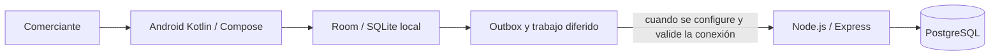

# Asistente conversacional offline para MYPES de Vinto

Prototipo de asistente configurable por rubro para registrar ventas y consultar el saldo local de existencias en MYPES del centro de Vinto, Cochabamba. Universidad Adventista de Bolivia, Carrera de Ingeniería en Sistemas.

El proyecto busca guardar primero en el teléfono y funcionar sin red durante la atención. No es un sistema completo de almacén: compras a proveedores, lotes, costos, facturación, cobro QR y otros módulos están fuera del alcance vigente.

## Estado del repositorio

Corte documental: 19/10/2026. Rama revisada: main, commit ec9028b.

- El backend es Node.js, TypeScript, Express y PostgreSQL. Su README describe login de propietario, catálogo protegido y recepción idempotente de lotes; el servicio está pensado para pruebas locales.
- El módulo Android está en mobile/: Kotlin, Jetpack Compose y persistencia local con Room. El código incluye login local con PIN, onboarding, dashboard, inventario y componentes de PLN/voz.
- El usuario reportó que instaló la app en un Motorola G60 y pudo guardar un producto de prueba. Esa prueba debe archivarse en evidence/ con pasos, fecha, entorno y commit para que sea repetible.
- El código móvil también contiene modelos de venta, outbox, WorkManager y cliente Retrofit. La integración completa móvil–API, especialmente desde un teléfono físico, todavía debe probarse. El cliente usa 10.0.2.2, dirección habitual del emulador Android, y el PIN local no equivale al token del backend.
- No hay una opción de interfaz para eliminar productos en la pantalla de inventario revisada. No afirmar que esa función está implementada.
- El modelo Vosk no se versiona en Git. El reconocimiento debe probarse después de instalar localmente el modelo requerido.
- La rama contiene código fuente, no un APK de distribución publicado. Una instalación local exitosa no certifica todas las funciones.

Consulta el estado, los criterios por materia y las brechas en la [Matriz de cumplimiento y evidencias](docs/13_Matriz_Cumplimiento_Tres_Materias_2026-2.md).

## Justificación del stack

El backend usa Node.js 24, TypeScript y Express; Node.js/Express coincide con la unidad de backend de Tecnologías en Internet. PostgreSQL es la base central elegida para las relaciones entre negocios, productos, ventas y operaciones, y para sus restricciones y transacciones. La app Android guarda sus datos locales con Room/SQLite.

La materia también incluye MongoDB/Mongoose y front-end web HTML/CSS/JavaScript. PostgreSQL no reemplaza MongoDB, y Android Compose no reemplaza un front-end web. La razón técnica del stack y las opciones académicas pendientes de confirmar están en el [plan de segunda entrega por materia](docs/14_Segunda_Entrega_Tareas_por_Materia.md).

## Arquitectura resumida



Este dibujo resume la arquitectura prevista; no prueba que todos los enlaces estén conectados en el dispositivo. El SAD 1.1 conserva una entrega anterior que incluye decisiones basadas en Spring Boot. La arquitectura vigente debe documentarse como una versión nueva y coherente con el código Node.js.

## Inicio local del backend

Hace falta Node.js 24, npm y Docker Desktop con Compose. Desde la raíz del repositorio:

```powershell
docker compose up -d postgres
Copy-Item backend/.env.example backend/.env
Set-Location backend
npm ci
npm run db:migrate
npm run dev
```

La comprobación de salud local está en http://127.0.0.1:3000/api/v1/health. Para login y catálogo, sigue el [README del backend](backend/README.md). No publiques backend/.env ni uses datos reales.

Para compilar e instalar Android, abre mobile/ en Android Studio, sincroniza Gradle, selecciona el teléfono/emulador y ejecuta la variante debug. La sincronización hacia la API debe tratarse como una prueba aparte.

## Documentos

| Documento | Propósito |
|---|---|
| [Matriz de cumplimiento](docs/13_Matriz_Cumplimiento_Tres_Materias_2026-2.md) | Criterios de ARQ-643, TEC-644 e INV-645, estados y evidencias por reunir |
| [Mapa del trabajo](docs/MAPA_PRESENTACION.md) | Relación del proyecto con las tres materias |
| [Perfil de Investigación I](docs/perfil/Perfil_final.md) | Perfil de Trabajo de Grado, versión 11 |
| [Proyecto y alcance](docs/01_Proyecto_y_Alcance.md) | Alcance vigente y exclusiones |
| [Requisitos y UX/UI](docs/02_Requisitos_y_UX.md) | Requisitos y diseño |
| [SAD](docs/03_SAD_Arquitectura.md) | SAD 1.1 entregado y nota sobre su estado |
| [Backend](backend/README.md) | Inicio local, autenticación, catálogo y API |
| [Android](mobile/README.md) | Módulo móvil y estado de integración |
| [Diagramas](diagrams/README.md) | Fuentes C4, casos de uso y coherencia pendiente |
| [Evidencias](evidence/README.md) | Cómo registrar pruebas revisables |

Los borradores sustituidos están en docs/archive/. No reemplazan las versiones vigentes ni deben presentarse sin revisar su estado.

## Equipo

Eva Lizeth Chino Quispe, Christian Gonzales Mamani, Marializ Mamani Quispe, Kevin Jhonathan Rocha Rojas y Luis Gerardo Lazo Bustamante.

## Diseño

- [Prototipo en Figma](https://snake-dijon-92194767.figma.site/)
- [Sistema de diseño](https://www.figma.com/make/jr73cU7am5OisMNhkgxkkr/Sistema-de-Dise%C3%B1o-MYPES-Vinto?p=f&fullscreen=1)

Figma muestra una propuesta de interfaz; no reemplaza la aplicación ni una prueba de funcionamiento.
