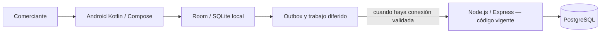

# DOCUMENTO DE ARQUITECTURA DE SOFTWARE (SAD v1.1 ENTREGADO)

> **Estado (rama `docs/arq-tec-cumplimiento-sin-perfil`):** se conserva aquí la versión **1.1 presentada**.  
> Desde el 13/10/2026 el nombre vigente del sistema no es “gestión de ventas e inventario”; ver `docs/Nota_de_nombre.md`.  
> **Esta v1.1 no se reescribe.** La arquitectura entregada describe Spring Boot/PostgreSQL.  
> La línea base **vigente en código** es **Node.js / TypeScript / Express / PostgreSQL** + **Android Kotlin / Compose / Room**.  
> Debe emitirse un **SAD v2.0** coherente con el código (drivers, ADR del cambio Spring→Node, C4 alineado, evaluación de calidad) y obtener aprobación docente. **Este archivo no es la entrega v2.0.**  
> **Perfil de Investigación:** documento aparte; no se versiona en este repositorio.

**UNIVERSIDAD ADVENTISTA DE BOLIVIA**
**FACULTAD DE CIENCIAS EXACTAS E INGENIERÍA — CARRERA DE INGENIERÍA EN SISTEMAS**
**ASIGNATURA:** Arquitectura de Software
**PROYECTO:** Proyecto Integrador Semestral — Gestión 2-2026

**SISTEMA:** Asistente Conversacional Offline con Procesamiento de Lenguaje Natural para la Gestión de Ventas e Inventario en MYPES del Centro de Vinto, Cochabamba

**INTEGRANTES:**
- Eva Chino Quispe — Líder de Proyecto, Requisitos y QA Documental
- Christian Gonzales — Ingeniería de IA y Pipeline Conversacional
- Marializ Mamani — Backend, Seguridad y Persistencia de Datos
- Kevin Rocha — Diseño UX/UI y Prototipado
- Luis Lazo — Arquitectura C4 y QA Técnico

**DOCENTE:** _(completar)_
**FECHA DE ENTREGA:** _(completar)_
**VERSIÓN:** 1.1

---

## CONTROL DE VERSIONES

| Versión | Fecha | Autor | Descripción del Cambio |
| :--- | :--- | :--- | :--- |
| 1.0 | _(fecha)_ | Equipo de Proyecto | Versión inicial del SAD. |
| 1.1 | _(fecha)_ | Equipo de Proyecto | Consolidación de las dos versiones previas del SAD en un único documento oficial. Se agrega columna "Artefacto" a los escenarios de calidad (estándar SEI/ATAM), se amplía a 5 tácticas arquitectónicas, se completa la matriz de trazabilidad (RA-01 a RA-05) y se resuelve la inconsistencia tecnológica entre ADR-002 (Vosk+TFLite vs. Gemma 3n) y ADR-003 (Spring Boot vs. Node.js), fijando como stack oficial: **Kotlin Nativo + Vosk/TFLite (edge) + SQLite/Room+SQLCipher + Spring Boot/PostgreSQL**. |
| 2.0 propuesta | 30/09/2026 | Equipo | Solicitud de unificar backend Node.js/TypeScript/Express y conservar PostgreSQL. Pendiente aprobación docente y revisión integral de diagramas, secuencias, seguridad y API. |
| Nota de estado | 2026-11 | Documentación | Se reafirma: v1.1 = entrega histórica; código vigente = Node + Android; SAD v2 pendiente de redactar como documento nuevo. |

---

## 1. INTRODUCCIÓN

El presente documento describe la arquitectura del **Asistente Conversacional Offline** para la gestión de ventas e inventario en las MYPES del centro de Vinto, Cochabamba. El sistema está diseñado en tecnologías nativas (Kotlin) para operar en dispositivos Android de gama baja, garantizando un consumo menor a 500 MB de RAM y operación 100% offline, con sincronización diferida hacia un backend en la nube cuando exista conectividad.

La versión 1.1 es la entrega histórica. Las menciones a Spring Boot describen esa línea base. La versión objetivo Node.js/PostgreSQL aún requiere revisión completa y aprobación; no se deben presentar las figuras antiguas como diagramas v2.0.

## 2. ANÁLISIS DEL PROBLEMA

### 2.1 Contexto
Vinto concentra microempresas familiares que operan con flujo de caja diario. Los comerciantes poseen teléfonos Android de gama baja (≤ 2 GB RAM), conectividad intermitente y, en muchos casos, baja alfabetización digital.

### 2.2 Problema Principal
El abandono de los sistemas de gestión comercial por parte de los comerciantes de Vinto ocurre **debido a la inadecuación de las arquitecturas de software comerciales frente a estas restricciones técnicas** y a la imposibilidad de interactuar mediante lenguaje natural en las herramientas actuales. Esto perpetúa el uso del cuaderno físico, generando errores de cálculo y pérdida de trazabilidad del negocio.

### 2.3 Causas y Consecuencias
- **Causas:** interfaces gráficas (GUI) complejas; sistemas que exigen hardware superior a 4 GB de RAM y conexión a Internet permanente; baja alfabetización digital de los usuarios objetivo.
- **Consecuencias:** errores de contabilidad manual, mercadería vencida o mal contabilizada, decisiones financieras tomadas "a ciegas".

### 2.4 Oportunidad de Solución
La evolución de la IA "Edge" (on-device) permite incrustar modelos de reconocimiento de voz (Vosk, ~50 MB) y clasificación de intención (TFLite) livianos, habilitando una interfaz conversacional 100% local, sin dependencia de Internet ni costo recurrente de API.

## 3. STAKEHOLDERS

| Stakeholder | Rol | Responsabilidad / Interés |
| :--- | :--- | :--- |
| **Comerciantes de Vinto** | Usuario final | Registrar ventas y controlar stock de forma verbal e intuitiva. |
| **Dueños de negocio** | Beneficiario | Tomar decisiones informadas; reducir pérdidas de mercadería. |
| **Equipo de desarrollo** | Equipo técnico | Implementar la arquitectura Kotlin nativa, el pipeline de PLN y la sincronización. |
| **Docentes UAB** | Evaluador | Validar el rigor arquitectónico, la viabilidad técnica y la defensa oral. |

## 4. ALCANCE

**Incluido:** arquitectura offline-first nativa; pipeline de PLN local (ASR con Vosk, clasificación de intención/entidades con TFLite); persistencia local cifrada (SQLite/Room + SQLCipher); sincronización diferida mediante patrón Outbox y resolución de conflictos LWW (Last Write Wins) contra un backend Spring Boot; confirmación visual obligatoria antes de persistir cualquier transacción dictada por voz.

**Excluido de esta primera entrega:** pasarelas de pago en línea; soporte nativo para iOS o Windows; facturación electrónica (SIN); analítica de negocio (BI) avanzada; el modelo **Gemma 3n** queda registrado como *stretch goal* opcional para fases posteriores, no como parte del pipeline oficial de esta entrega.

> Alcance vigente del prototipo: ver `docs/01_Proyecto_y_Alcance.md`.

## 5. REQUISITOS ARQUITECTÓNICAMENTE SIGNIFICATIVOS (Drivers)

| ID | Requisito | Impacto Arquitectónico | Prioridad |
| :--- | :--- | :--- | :--- |
| **RA-01** | Soportar operación 100 % offline en Android de gama baja | Define Kotlin nativo y persistencia local (SQLite/Room), descartando PWA o soluciones híbridas. | Alta |
| **RA-02** | Procesar voz a texto e intención en el dispositivo, sin red | Define la integración de Vosk (ASR, ~50 MB) + TFLite (clasificador de intención/entidades) incrustados en el APK. | Alta |
| **RA-03** | Evitar inconsistencias de datos al recuperar la conexión | Obliga a implementar patrón Outbox local y resolución de conflictos LWW en el backend Spring Boot. | Alta |
| **RA-04** | Tiempo de respuesta del procesamiento verbal ≤ 2 s | Fuerza la optimización de latencia en la capa de PLN (modelos cuantizados, inferencia en background thread). | Alta |
| **RA-05** | Permitir la incorporación de nuevos módulos (p. ej. reportes avanzados) | Requiere diseño modular y bajo acoplamiento (Clean Architecture + inyección de dependencias). | Media |
| **RA-06** | Garantizar la confidencialidad e integridad de los datos financieros y comerciales | Define cifrado AES-256 en reposo (SQLCipher), TLS 1.3 en tránsito, hashing con sal (Argon2) y Android Keystore (ver ADR-004). *Elaborado por Marializ Mamani.* | Alta |

## 6. ATRIBUTOS DE CALIDAD PRIORIZADOS

| Atributo | Prioridad | Justificación |
| :--- | :--- | :--- |
| **Disponibilidad** | Alta | El sistema debe operar en el mercado sin depender de datos móviles ni Wi-Fi. |
| **Rendimiento** | Alta | La interacción conversacional fluida exige respuestas en ≤ 2 s y consumo < 500 MB de RAM en hardware limitado. |
| **Confiabilidad** | Alta | El sistema debe interpretar correctamente pese al ruido ambiental de mercado y a modismos dialectales locales. |
| **Usabilidad** | Alta | Dirigido a usuarios con baja alfabetización digital; la voz reemplaza formularios complejos. |
| **Seguridad** | Media | Debe proteger la información financiera y de inventario almacenada localmente ante robo o pérdida del dispositivo. |

*Orden de prioridad fundamentado:* 1° Disponibilidad Offline, 2° Rendimiento, 3° Confiabilidad/Usabilidad, 4° Seguridad.

## 7. ESCENARIOS DE CALIDAD

*Estructura ATAM: Fuente → Estímulo → Entorno → Artefacto → Respuesta → Medida.*

| ID | Atributo | Fuente | Estímulo | Entorno | Artefacto | Respuesta | Medida |
| :--- | :--- | :--- | :--- | :--- | :--- | :--- | :--- |
| **QS-01** | Rendimiento | Usuario | Dicta un comando de voz largo | App en uso normal | Motor PLN Edge (Vosk + TFLite) | Transcribe y extrae intención/entidades | ≤ 2 s de latencia total |
| **QS-02** | Disponibilidad | Usuario | Abre la app sin Wi-Fi/datos | Sin conexión de red | Capa de persistencia local (SQLite/Room) | Todas las vistas y operaciones funcionan sin red | 100 % de las funciones core disponibles |
| **QS-03** | Confiabilidad | Ruido externo (mercado) | Dicta una venta con ruido ambiental | Ambiente ruidoso | Motor ASR Vosk | Extrae producto, cantidad y monto correctos | Precisión de extracción ≥ 85 % |
| **QS-04** | Seguridad | Tercero no autorizado | Robo o pérdida del dispositivo | Dispositivo fuera de línea | Base de datos local (SQLCipher AES-256) | La base de datos resulta ilegible sin la clave | 100 % de los datos cifrados en reposo |
| **QS-05** | Usabilidad | Usuario (primera vez) | Usa la app por primera vez para registrar una venta | Operación normal | UI & VUI Controller (Jetpack Compose) | Completa el registro sin ayuda externa | Puntaje SUS ≥ 70 pts |

### 7.1 Escenarios de profundización — Seguridad (Marializ Mamani)

| ID | Atributo | Estímulo y Entorno | Respuesta Esperada | Medida Propuesta |
| :--- | :--- | :--- | :--- | :--- |
| QS-06 | Seguridad | Atacante externo extrae el archivo SQLite del dispositivo. | Datos cifrados con AES-256, ilegibles sin clave. | Tiempo de crackeo estimado > 100 años por fuerza bruta. |
| QS-07 | Seguridad | PIN incorrecto 3 veces consecutivas. | Bloqueo temporal y registro del intento. | Bloqueo tras 3 intentos; registro de auditoría. |
| QS-08 | Seguridad | Ataque Man-in-the-Middle en WiFi pública durante sincronización. | TLS 1.3 + Certificate Pinning. | Conexión rechazada sin certificado válido. |
| QS-09 | Seguridad | Privilegio root/jailbreak al iniciar. | Advertencia y limitación de funciones críticas. | Detección de root en < 2 s. |

### 7.2 Escenario de profundización — Usabilidad (Luis Lazo)

| ID | Atributo | Estímulo y Entorno | Respuesta Esperada | Medida Propuesta |
| :--- | :--- | :--- | :--- | :--- |
| QS-10 | Usabilidad / Sincronización | Usuario nuevo intenta registrar una venta con instrucciones mínimas. | Completa la tarea con confirmación visual y fallback a teclado. | SUS ≥ 70 y tasa de éxito ≥ 85 % (5 usuarios objetivo). |

## 8. TÁCTICAS ARQUITECTÓNICAS

| Atributo | Problema | Táctica Seleccionada | Justificación |
| :--- | :--- | :--- | :--- |
| **Rendimiento** | Limitación de RAM (< 2 GB) | **Desarrollo nativo (Kotlin)** | Acceso de bajo nivel; evita sobrecarga de frameworks híbridos. |
| **Disponibilidad** | Ausencia de Internet | **Offline-First (base embebida)** | SQLite/Room como fuente de verdad local. |
| **Confiabilidad** | Falsos positivos por ruido | **Confirmación visual obligatoria** | Tarjeta de UI que exige confirmación antes de persistir. |
| **Confiabilidad** | Modismos dialectales | **Vocabulario dinámico** | Configuración de Vosk con términos locales. |
| **Modificabilidad** | Nuevos módulos | **Encapsulamiento + Clean Architecture** | Capas Presentación / Dominio / Datos. |
| **Seguridad** | Interceptación en sincronización | **TLS 1.3 + Certificate Pinning** | Mitiga MitM (QS-08). |
| **Seguridad** | PIN comprometido | **Hashing con sal + bloqueo temporal** | QS-07. |
| **Seguridad** | Dispositivos root | **Detección de Root + restricción** | QS-09. |

## 9. DECISIONES ARQUITECTÓNICAS INICIALES (ADRs)

### ADR-001: Tecnología Móvil — Nativo vs. Híbrido
- **Estatus:** Aprobado
- **Contexto:** Dispositivos de Vinto con ≤ 2 GB RAM.
- **Decisión:** **Kotlin nativo** con Jetpack Compose.
- **Alternativas:** React Native, Flutter, PWA.
- **Justificación:** Menor sobrecarga de memoria; control directo del ciclo de vida.
- **Consecuencias:** acoplado a Android; sin versión web/iOS en esta fase.

### ADR-002: Pipeline de PLN — Cloud vs. Edge
- **Estatus:** Aprobado
- **Decisión:** Pipeline **100 % on-device**: **Vosk** + clasificador **TFLite**. Confianza < 0.75 dispara aclaración o teclado.
- **Alternativas:** Google Speech, Whisper Cloud, Gemma 3n.
- **Justificación:** offline total, privacidad, costo marginal cero.
- **Consecuencias:** mayor peso del APK; optimización de batería/RAM.

### ADR-003: Arquitectura de Sincronización y Backend (histórico v1.1)
- **Estatus:** Aprobado en v1.1 (histórico)
- **Decisión histórica:** Outbox local, UUID v4, backoff exponencial, LWW, backend **Java Spring Boot + PostgreSQL**.
- **Nota de estado 2026-11:** el **código vigente** usa **Node.js / TypeScript / Express / PostgreSQL**. El cambio debe documentarse en **SAD v2** con ADR nuevo (contexto, alternativas, consecuencias) sin borrar esta decisión histórica.

### ADR-004: Cifrado de Base de Datos Local — SQLCipher AES-256
- **Estatus:** Aprobado
- **Decisión:** Híbrida: SQLCipher AES-256 en reposo; TLS 1.3 en tránsito; clave en Android Keystore; PIN con hash Argon2.
- **Justificación:** satisface RA-01 y RA-06; escenarios QS-06 a QS-09.

## 10. MODELO C4 (propuesta v1.1)

Los diagramas C1/C2 de la v1.1 describen Spring Boot en el backend cloud. Deben actualizarse en el **SAD v2** al stack Node.js/Express y al estado real de implementación en `backend/` y `mobile/`. Las fuentes editables están en `diagrams/`.

> El diagrama anterior resume la **arquitectura vigente en código**. No sustituye la evaluación formal ni prueba que todos los enlaces estén integrados en dispositivo físico.

## 11. RECORDATORIO PARA SAD v2 (criterios ARQ-643)

- [ ] Portada y control de versiones propios (no sobrescribir v1.1).
- [ ] ADR del cambio Spring Boot → Node.js/Express.
- [ ] C1/C2/despliegue alineados a `backend/` y `mobile/`.
- [ ] Escenarios de calidad con resultados medidos o “pendiente de medición” honestos.
- [ ] Trazabilidad requisito → escenario → decisión → evidencia.
- [ ] Nombre y alcance alineados a `docs/01_Proyecto_y_Alcance.md`.

---

*Fin del SAD v1.1 con nota de estado. El cuerpo histórico de la entrega académica se mantiene como base; la evaluación de arquitectura vigente se completa con el SAD v2 y evidencias en `evidence/`.*
