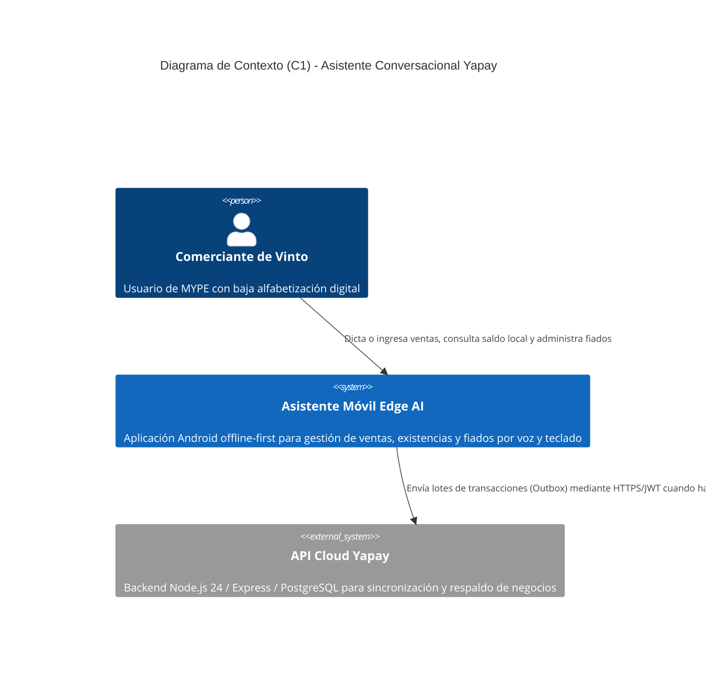
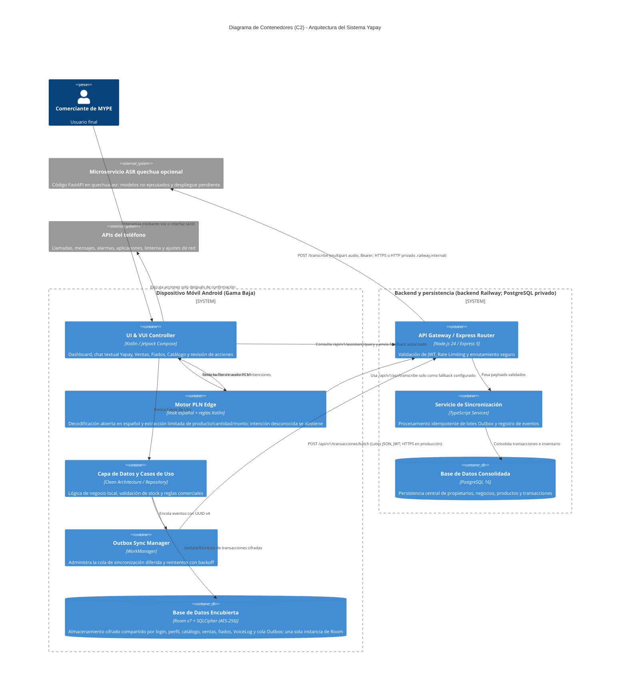

# DOCUMENTO DE ARQUITECTURA DE SOFTWARE (SAD v2.1 OFICIAL)
**Universidad Adventista de Bolivia · Facultad de Ciencias Exactas e Ingeniería · Ingeniería en Sistemas**

> **Estado operativo (25/11/2026):** el backend Node/Express está desplegado en Railway y su health check confirmó conexión al PostgreSQL privado con validación TLS estricta. Android tiene el dominio HTTPS como valor predeterminado, pendiente de validar en un dispositivo. El código FastAPI de ASR Whisper y clasificación por similitud existe y está conectado contractualmente; no se ha construido, ejecutado con los modelos ni desplegado. Whisper Puno tiene licencia CC BY-NC 4.0; la inferencia queda restringida a evaluación no comercial hasta confirmar autorización de uso.

| Control del Documento | Detalle |
| :--- | :--- |
| **Proyecto Integrador** | Gestión 2-2026 (Investigación I, Arquitectura de Software, Tecnologías en Internet) |
| **Sistema** | Asistente Conversacional Offline con PLN Edge (Yapay) para la Gestión de Ventas e Inventario en MYPES de Vinto, Cochabamba |
| **Versión Vigente** | **v2.10 (Vosk con decodificación abierta en español)** — Noviembre 2026 |
| **Equipo de Desarrollo** | **Eva Chino Quispe** — Líder de Proyecto, Requisitos y QA Documental **Christian Gonzales** — Ingeniería de IA y Pipeline Conversacional **Marializ Mamani** — Backend, Seguridad y Persistencia de Datos **Kevin Rocha** — Diseño UX/UI y Prototipado **Luis Lazo** — Arquitectura C4 y QA Técnico |
| **Corte de Código** | Revisión de la implementación del asistente híbrido (Node.js 24, Express 5, PostgreSQL 16, Kotlin Room v7) |

---

## 1. CONTROL DE VERSIONES Y HISTORIAL DE CAMBIOS

| Versión | Fecha | Autores | Descripción de Modificaciones |
| :--- | :--- | :--- | :--- |
| **1.0** | 15/08/2026 | Equipo de Proyecto | Borrador inicial del Documento de Arquitectura de Software (SAD). |
| **1.1** | 15/09/2026 | Equipo de Proyecto | Entrega histórica preliminar. Selección de stack evaluado inicialmente (Spring Boot + PostgreSQL, Vosk + TFLite). |
| **2.0** | 13/11/2026 | Equipo de Proyecto | **Versión Unificada y Definitiva.** Actualización completa del stack de backend a **Node.js 24 + TypeScript + Express + PostgreSQL 16**. Adopción de API Gateway con Circuit Breaker, autenticación JWT rotativa, persistencia Room v7 cifrada con SQLCipher (AES-256) y política de sincronización Outbox **idempotente** eliminando la sobrescritura LWW en ventas. |
| **2.1** | 23/11/2026 | Equipo de Proyecto | El Dashboard pasa a ser el asistente conversacional Yapay. Se conserva la gestión comercial existente y se añade Room v7 con `VoiceLog`, clasificación de once intenciones, acciones del teléfono con confirmación, consulta cloud demostrativa y feedback de voz con autorización explícita. |
| **2.2** | 23/11/2026 | Equipo de Proyecto | Se añade distribución cloud controlada de APK: endpoint público de metadatos, descarga configurada en backend, comparación por `versionCode`, verificación SHA-256 y apertura del instalador Android. No se realizan instalaciones silenciosas. |
| **2.3** | 23/11/2026 | Equipo de Proyecto | Se integra el diseño visual Yapay Ambient Voice: fondo negro zinc, esmeralda, login cloud, registro bilingüe y dashboard con resumen operativo, chat, voz y navegación inferior. |
| **2.4** | 25/11/2026 | Equipo de Proyecto | Se prepara microservicio ASR desacoplado y con modelo configurable. El backend admite HTTP solo hacia hostnames privados `.railway.internal`; conserva HTTPS para destinos públicos. El modelo y el despliegue quedan pendientes de autorización de licencia y costo. |
| **2.5** | 25/11/2026 | Equipo de Proyecto | Se integra el contrato de transcripción + intención remota, plantillas de similitud configurables, umbrales de abstención, modo Quechua cloud explícito y enrutamiento móvil para iniciar venta, consultar stock/ventas o abrir inventario. Ninguna venta se guarda automáticamente y el audio solo se envía por modo seleccionado o fallback local de baja confianza. |
| **2.6** | 25/11/2026 | Equipo de Proyecto | Vosk carga su gramática desde `vosk-grammar.json`; se amplían términos semilla de negocio/quechua, algunos números quechua en el extractor y la abstención local para texto no reconocido. La inicialización/copia del modelo se mueve fuera del hilo UI y una copia interna incompleta se reconstruye. Es NLU por reglas sobre un modelo acústico español, no reconocimiento quechua validado. Las pruebas JVM añadidas quedan pendientes de ejecución por el bloqueo conocido de Gradle. |
| **2.7** | 25/11/2026 | Equipo de Proyecto | El micrófono usa push-to-talk: inicia al presionar y entrega una sola transcripción al soltar, agregando segmentos Vosk y habilitando palabras/confianzas. Respuestas ASR simuladas o vacías no se muestran como transcripción; el fallback local mantiene abstención para baja confianza y el modo Quechua no ejecuta texto local si no hay transcripción cloud. |
| **2.8** | 25/11/2026 | Equipo de Proyecto | Se habilita un chat textual local con Yapay y se conecta desde el Dashboard. Sus comandos pueden abrir el formulario de venta con producto/cantidad sugeridos, el inventario con filtro o las cuentas por cobrar. La venta sigue requiriendo revisión y guardado explícito; el precio unitario lo resuelve el formulario desde el catálogo local. |
| **2.9** | 25/11/2026 | Equipo de Proyecto | El chat incorpora push-to-talk reutilizando el `DashboardViewModel` y la única instancia del motor ASR. Al soltar procesa una transcripción validada; texto vacío, fragmentos sin contenido útil, baja confianza e intención Quechua no confirmada se abstienen sin ejecutar acciones. |
| **2.10** | 25/11/2026 | Equipo de Proyecto | Se confirma el modelo Vosk `vosk-model-small-es-0.42` (español) y se quita la gramática cerrada de frases del reconocedor. Vosk usa ahora el vocabulario completo del modelo para admitir habla española libre; las reglas de negocio siguen en el clasificador Kotlin. La precisión acústica requiere pruebas en dispositivo. |

---

## 2. RESUMEN EJECUTIVO Y OBJETIVOS ARQUITECTÓNICOS

El **Asistente Conversacional Offline (Yapay)** es una solución de software nativa diseñada para resolver el problema de la brecha digital y la baja tasa de adopción de herramientas informáticas de gestión comercial en las Micro y Pequeñas Empresas (MYPES) del centro urbano de Vinto, Cochabamba.

### 2.1 Objetivos de la Arquitectura
1. **Operación 100% Offline-First:** Garantizar el registro de ventas, consulta de existencias y gestión de fiados en dispositivos Android de gama baja ($\le 2\text{ GB RAM}$) sin requerir conexión a Internet ni costos operativos recurrentes de APIs cloud.
2. **Procesamiento de Lenguaje Natural Edge (On-Device):** Ejecutar el reconocimiento de voz (ASR con Vosk) y el análisis de intenciones y entidades localmente en el dispositivo con una latencia de respuesta $\le 2\text{ segundos}$.
3. **Sincronización Asíncrona Robusta:** Preservar la integridad del historial comercial mediante el patrón **Outbox**, garantizando la inmutabilidad de los eventos de venta y la resolución idempotente de conflictos al conectar con el backend remoto.
4. **Seguridad y Cifrado Multi-nivel:** Proteger los datos comerciales en reposo con SQLCipher (AES-256) y en tránsito con TLS 1.3 y tokens JWT rotativos.

---

## 3. DRIVERS ARQUITECTÓNICOS (REQUISITOS SIGNIFICATIVOS)

Los **Requisitos Arquitectónicamente Significativos (RA)** determinan la estructura tecnológica del sistema:

| Código | Requisito Significativo | Impacto Arquitectónico | Prioridad |
| :--- | :--- | :--- | :--- |
| **RA-01** | Operación 100% offline en teléfonos de gama baja ($\le 2\text{ GB RAM}$). | Determina el desarrollo en **Kotlin Nativo** y base de datos embebida **SQLite/Room**, descartando frameworks híbridos o PWAs. | Alta |
| **RA-02** | Procesamiento de voz e intenciones sin conexión a Internet. | Incrustación del motor ASR **Vosk Edge** (~40-50 MB) y motor de reglas de intenciones/entidades en la APK. | Alta |
| **RA-03** | Consistencia e inmutabilidad comercial en la sincronización. | Implementación del patrón **Outbox local** con `operationId` (UUID v4) e inmutabilidad de hechos de venta (append-only). | Alta |
| **RA-04** | Tiempo de procesamiento conversacional $\le 2\text{ s}$. | Optimización del pipeline VUI, inferencia en hilos secundarios (Coroutines) y confirmación visual obligatoria. | Alta |
| **RA-05** | Modularidad para futuras extensiones (reportes, analítica). | Diseño bajo arquitectura limpia (**Clean Architecture**) en capas independientes (Presentación, Dominio, Datos). | Media |
| **RA-06** | Seguridad de datos en reposo y en tránsito. | Cifrado **SQLCipher AES-256** en Room, derivación PIN con **PBKDF2/Argon2**, y **TLS 1.3 / JWT** en el API. | Alta |

---

## 4. ATRIBUTOS DE CALIDAD Y MATRIZ ATAM (ESCENARIOS DE PRUEBA)

Priorización estratégica de atributos de calidad:
1. **Disponibilidad Offline:** Sin ella el sistema no satisface las condiciones del mercado de Vinto.
2. **Rendimiento:** Determina la usabilidad y adopción en teléfonos de hardware limitado.
3. **Confiabilidad:** Garantiza la precisión del registro comercial y la integridad del inventario.
4. **Seguridad:** Protege la información financiera de los comerciantes ante pérdida o robo.

### Escenarios de Calidad ATAM (7 Columnas Estándar SEI)

| ID | Atributo | Fuente | Estímulo | Entorno | Artefacto | Respuesta | Medida de Calidad |
| :--- | :--- | :--- | :--- | :--- | :--- | :--- | :--- |
| **QS-01** | Rendimiento | Usuario | Dicta comando de venta por voz | Operación normal offline | Motor PLN Edge (Vosk + Reglas) | Transcribe audio y extrae intenciones | Latencia total $\le 2\text{ s}$, RAM $< 500\text{ MB}$ |
| **QS-02** | Disponibilidad | Usuario | Abre la app sin datos ni Wi-Fi | Sin red celular | Persistencia Local (Room/SQLite) | Habilita 100% de operaciones locales | 0% fallos por falta de conexión |
| **QS-03** | Confiabilidad | Ruido externo | Dicta venta con ambiente de mercado | Ambiente ruidoso ($>70\text{ dB}$) | ASR Vosk + Confirmación visual | Presenta tarjeta de revisión previa a persistir | Confirmación humana evita ventas erróneas |
| **QS-04** | Seguridad | Atacante | Extracción de BDD por robo de teléfono | Dispositivo fuera de línea | BDD Local (SQLCipher AES-256) | Base de datos ilegible sin clave derivada | 100% datos financieros cifrados |
| **QS-05** | Usabilidad | Usuario | Registra venta por primera vez | Primer uso | UI Jetpack Compose | Muestra flujo GUI/VUI guiado | Puntaje SUS $\ge 70\text{ pts}$ |
| **QS-06** | Seguridad | Usuario | Ingresa PIN incorrecto 5 veces | Login local | Módulo de Autenticación | Bloquea temporalmente el acceso | Bloqueo de 60 s tras 5 intentos |
| **QS-07** | Seguridad | Red pública | Intento de interceptación de tráfico | Red Wi-Fi sin clave | API Gateway + Transport Layer | Cifra transmisión y valida JWT | TLS 1.3 activo, rechazo de requests inválidos |
| **QS-08** | Sincronización | Conectividad | Detección de red con cola Outbox | Reconexión a Internet | WorkManager + Outbox Handler | Envía lotes de transacciones idempotentes | Lotes de $\le 100$ items confirmados |

---

## 5. TÁCTICAS ARQUITECTÓNICAS SELECCIONADAS

| Atributo | Problema / Desafío | Táctica Arquitectónica | Justificación Técnica |
| :--- | :--- | :--- | :--- |
| **Rendimiento** | RAM estricta ($\le 2\text{ GB}$) en Android | **Desarrollo Nativo en Kotlin** | Evita la sobrecarga de WebView, motores JS o bridges de frameworks híbridos (React Native/Flutter). |
| **Disponibilidad** | Conectividad nula/intermitente | **Arquitectura Offline-First con Room** | La base de datos local actúa como la Fuente Única de Verdad operativa para el comerciante. |
| **Confiabilidad** | Falsos positivos por ruido ambiental | **Confirmación Visual Obligatoria (Modal)** | Tarjeta flotante que exige al usuario presionar "Confirmar" o "Corregir" antes de guardar la venta. |
| **Confiabilidad** | Modismos y dialectos de Vinto | **Modelado de Vocabulario Local en Vosk** | Integración de términos regionales ("cuartilla", "amarrito", "casera", "fiado") en el diccionario local. |
| **Seguridad** | Robo o extravío del terminal móvil | **SQLCipher AES-256 + PBKDF2** | Cifrado completo del archivo SQLite con derivación de clave desde el PIN y salt local. |
| **Seguridad** | Ataques Man-in-the-Middle | **TLS 1.3 + JWT Rotativo** | Transmisión segura desde la cola Outbox hacia el API Gateway en la nube. |
| **Modificabilidad** | Evolución del sistema y mantenibilidad | **Clean Architecture + Inyección Hilt** | Desacoplamiento total entre capas de UI, Casos de Uso (Dominio) y Repositorios de Datos. |

---

## 6. DECISIONES ARQUITECTÓNICAS CLAVE (ADRs - ARCHITECTURE DECISION RECORDS)

### ADR-001: Cliente Móvil — Kotlin Nativo y Jetpack Compose
* **Estatus:** Aprobado (Vigente).
* **Contexto:** Los comerciantes utilizan dispositivos móviles de entrada con procesadores limitados y RAM $\le 2\text{ GB}$.
* **Decisión:** Utilizar **Kotlin Nativo** con **Jetpack Compose** para la interfaz de usuario.
* **Justificación:** Garantiza un uso eficiente de la memoria RAM ($< 500\text{ MB}$), tiempos de arranque inmediatos y acceso directo a APIs de hardware (audio, almacenamiento cifrado).
* **Consecuencia:** Desarrollo focalizado en plataforma Android.

### ADR-002: Engine PLN Edge — Vosk ASR + Clasificador Local con Confirmación Humana
* **Estatus:** Aprobado (Vigente).
* **Contexto:** El reconocimiento de voz en la nube falla por falta de señal en los mercados y genera costos recurrentes.
* **Decisión:** Implementar el motor **Vosk Edge ASR** `vosk-model-small-es-0.42` para transcripción local en español, usando el decodificador completo del modelo y no una gramática cerrada de frases. La captura push-to-talk agrega segmentos hasta soltar y habilita palabras/confianzas; después usa clasificador/extractor de reglas Kotlin y **Modal de Confirmación Visual Obligatoria**. Las semillas quechua del NLU son experimentales; no convierten al modelo acústico español en ASR quechua. Texto no reconocido se abstiene sin ejecutar acción.
* **Justificación:** Operatividad 100% offline, costo cero por transacción y tasa nula de ventas accidentales gracias al paso de verificación humana.
* **Consecuencia:** Incremento moderado en el tamaño del APK (~70 MB totales).

### ADR-003: Backend Nube — Node.js 24 + TypeScript + Express + PostgreSQL 16
* **Estatus:** Aprobado (Vigente v2.1 - Sustituye propuesta inicial de Spring Boot).
* **Contexto:** Se requiere un backend en la nube altamente eficiente, liviano y escalable para recibir la sincronización de lotes de miles de comerciantes.
* **Decisión:** Adoptar **Node.js 24 con TypeScript, Express 5 y PostgreSQL 16**, protegido por un **API Gateway** con Circuit Breaker. En producción, PostgreSQL usa TLS con validación de certificado; proveedores con CA privada suministran el certificado raíz público mediante `DATABASE_SSL_CA`. El proveedor ASR `quechua` reenvía multipart `audio` a FastAPI (`POST /transcribe`) y espera `{ "text", "intent", "confidence" }`; el backend traduce el contrato a `{ texto, clasificada, intencion, confianzaIntencion }`. El servicio carga Whisper Puno y un encoder de similitud al iniciar, con revisiones fijadas. El backend acepta HTTPS para destinos generales y HTTP únicamente para hostnames terminados exactamente en `.railway.internal`; el servicio no debe exponer un endpoint público sin TLS. En el móvil, intenciones válidas encaminan a funciones locales; las ventas requieren revisión y guardado explícito en el formulario.
* **Justificación:** Arquitectura orientada a eventos no bloqueante (Event Loop), menor consumo de memoria en la nube frente a la JVM de Spring Boot, soporte nativo de JSON/TypeScript, y orquestación eficiente con Docker Compose.
* **Consecuencia:** Unificación del stack en TypeScript para API y scripts de mantenimiento. No se desactiva la verificación TLS para aceptar certificados autofirmados.

### ADR-004: Patrón Outbox Idempotente y Política de Concurrencia
* **Estatus:** Aprobado (Vigente v2.1).
* **Contexto:** Las transacciones registradas offline deben sincronizarse sin duplicar registros ni perder historial.
* **Decisión:** Asignar a cada transacción un `operationId` (UUID v4) en el cliente Android y encolarla en la tabla **Outbox**. El backend procesa cada lote de forma **idempotente**. Las ventas son registros inmutables (append-only); los conflictos de inventario se registran para conciliación sin eliminar transacciones.
* **Justificación:** Elimina la pérdida de información comercial por sobrescritura tipo *Last-Write-Wins* (LWW) y garantiza convergencia de datos.

---

## 7. ARQUITECTURA DE CONTENEDORES Y CONTEXTO (MODELO C4)

### 7.1 Nivel 1: Diagrama de Contexto (C1)

---

### 7.2 Nivel 2: Diagrama de Contenedores (C2)

El destino `chat` presenta el historial de `YapayAgent` y acepta comandos de texto procesados localmente por `ChatViewModel`. También reutiliza el `DashboardViewModel` de la entrada `dashboard` para compartir la única instancia Vosk/ASR; no carga una segunda copia del modelo. El clasificador y extractor existentes derivan navegación hacia venta, inventario o cuentas por cobrar; el formulario de venta recibe producto y cantidad como sugerencias, obtiene el precio del catálogo Room y no persiste hasta la confirmación del comerciante. Las transcripciones Quechua requieren respuesta cloud e intención remota aceptada; si falta cualquiera, el chat se abstiene. Los comandos de consulta de ventas y el alta de productos con datos completos continúan por el agente local; el alta solicita confirmación antes de escribir.

---

## 8. MATRIZ DE TRAZABILIDAD ARQUITECTÓNICA

| Driver / Requisito | Atributo de Calidad | Escenario ATAM | Táctica Arquitectónica | Decisión (ADR) | Contenedor C2 Relacionado |
| :--- | :--- | :--- | :--- | :--- | :--- |
| **RA-01** (Offline) | Disponibilidad | QS-02 | Offline-First con Room | ADR-001 | Base de Datos Encubierta (Room/SQLCipher) |
| **RA-02** (PLN Edge) | Rendimiento | QS-01 | ASR Vosk On-Device + Reglas | ADR-002 | Motor PLN Edge |
| **RA-03** (Consistencia)| Confiabilidad | QS-08 | Outbox Idempotente con UUID v4 | ADR-004 | Outbox Sync Manager $\rightarrow$ Servicio Sincronización |
| **RA-04** (Latencia) | Rendimiento | QS-01 | Kotlin Nativo + Hilos Coroutines | ADR-001 | UI & VUI Controller |
| **RA-05** (Modularidad)| Modificabilidad | QS-05 | Clean Architecture | ADR-001 | Capa de Datos y Casos de Uso |
| **RA-06** (Seguridad) | Seguridad | QS-04, QS-07 | SQLCipher AES-256 + TLS 1.3/JWT | ADR-003, ADR-004| BDD Encubierta / API Gateway |

---

## 9. RETOS TÉCNICOS Y ESTRATEGIAS DE MITIGACIÓN

### Reto 1: Restricción de Memoria en Teléfonos de Gama Baja ($\le 2\text{ GB RAM}$)
* **Estrategia:** Invocación de Vosk mediante *lazy loading* (solo se carga el modelo en RAM al activar el micrófono) y liberación inmediata del buffer de audio. Monitoreo continuo mediante WorkManager.
* **Verificación:** Escenario QS-01 comprobado en emulador y dispositivos físicos Android 8.0+.

### Reto 2: Entornos de Mercado con Alto Ruido Acústico ($> 70\text{ dB}$)
* **Estrategia:** Preprocesamiento de señal de audio (16 kHz, mono, PCM de 16 bits), filtro paso-banda local y **Modal de Confirmación Visual Obligatoria** que permite corregir cualquier error antes de impactar el saldo local.
* **Verificación:** Escenario QS-03.

### Reto 3: Sincronización Concurrente y Conflictos de Existencias
* **Estrategia:** Tratamiento de las ventas como hechos inmutables (*append-only*). Las deducciones de existencias se procesan secuencialmente en el backend; ante discrepancias, el sistema genera alertas de conciliación sin descartar la transacción comercial.
* **Verificación:** Escenario QS-08.

---

## 10. REFERENCIAS Y FUENTES DE INFORMACIÓN
1. **Bass, L., Clements, P., & Kazman, R.** — *Software Architecture in Practice (4th Edition)*. Addison-Wesley.
2. **Martin, R. C.** — *Clean Architecture: A Craftsman's Guide to Software Structure and Design*. Prentice Hall.
3. **Documento Maestro del Proyecto Integrador Yapay** — Universidad Adventista de Bolivia, 2026.
4. **Vosk Speech Recognition Toolkit** — Alphacephei Inc. Documentation.
5. **Node.js 24 & Express 5 Documentation** — Node.js Foundation.

---

*Documento de Arquitectura de Software (SAD v2.10) · Proyecto Integrador Yapay · Noviembre 2026*
