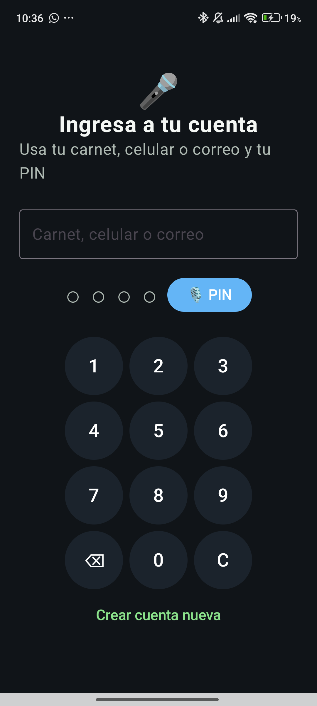

# Plan de pruebas

Los casos se mantienen pendientes hasta completar su criterio de evidencia. Para una prueba funcional Android, el estado solo cambia a **APROBADO** cuando el escenario se ejecutó y existe captura/video en la carpeta indicada. Para backend, se registra el resultado del workflow real de GitHub Actions; una ejecución local se etiqueta explícitamente como local.

Estados: `PENDIENTE`, `APROBADO`, `FALLIDO`, `BLOQUEADO`.

## Login

| ID de Prueba | Descripción | Resultado Esperado | Estado (Aprobado/Fallido) |
|---|---|---|---|
| LOGIN-01 | Ingresar con PIN local válido | Se abre el panel sin requerir Internet | PENDIENTE |
| LOGIN-02 | Ingresar con PIN incorrecto | Se rechaza el acceso y se aplica la política local de intentos | PENDIENTE |
| LOGIN-03 | Ingresar identificador local válido con PIN | Se encuentra el perfil por carnet, celular o correo, sin distinguir mayúsculas/minúsculas | PENDIENTE |
| LOGIN-04 | Dictar "uno, dos, tres, cuatro" en el login | El PIN se completa como `1234`; no se intenta el acceso con una extracción ambigua | PENDIENTE de prueba funcional en dispositivo |



Evidencia disponible: captura real de la pantalla principal del login en un dispositivo Android conectado. Esta toma confirma que la UI carga correctamente, pero no sustituye la validación del dictado por voz ni del acceso con credenciales reales.

No se marcan como aprobadas pruebas funcionales de Android sin captura o video en `docs/evidencias/`. Cuando se capturen los casos de acceso real, agregar los siguientes bloques en esta sección:

```markdown


```

Los archivos anteriores quedan pendientes de captura; la evidencia actual disponible solo cubre la carga visual de la pantalla.

## Registro

| ID de Prueba | Descripción | Resultado Esperado | Estado (Aprobado/Fallido) |
|---|---|---|---|
| REG-01 | Prueba de integración API: registrar propietario y negocio con correo único | Se guardan propietario y negocio, y la sesión Bearer permite usar una ruta protegida | APROBADO (integración local con PostgreSQL temporal) |
| REG-02 | Prueba de integración API: volver a registrar el mismo correo | Se responde `409` y no se crea un negocio huérfano | APROBADO (integración local con PostgreSQL temporal) |
| REG-03 | Prueba de integración API: enviar campos incompletos y contraseña corta | Se responde `400` antes de crear cuentas | APROBADO (integración local con PostgreSQL temporal) |
| REG-04 | Completar el formulario Android con conexión | El perfil personal se conserva en Room y PostgreSQL, el token se guarda y se crea un negocio provisional para completar en onboarding | PENDIENTE de prueba funcional |
| REG-05 | Registrar sin conexión, completar onboarding y crear la cuenta desde Sincronización | El perfil permanece local, la contraseña no se persiste; al reingresarla se crea la cuenta remota con los datos actuales del perfil | PENDIENTE de prueba funcional |
| REG-06 | Migrar una base Room versión 4 con usuario existente | La actualización a versión 6 conserva el PIN y los datos anteriores y agrega los campos personales nuevos | PENDIENTE de prueba en dispositivo/base existente |
| REG-07 | Crear la cuenta remota desde un perfil local con conexión | Se registran perfil y negocio en PostgreSQL, se guarda el token y se puede iniciar la sincronización | PENDIENTE de prueba funcional |
| REG-08 | Integración backend del perfil ampliado, negocio provisional y actualización protegida | La migración 005 aplica y `PUT /api/v1/auth/business` modifica solo el negocio del token | BLOQUEADO por disponibilidad/autenticación de PostgreSQL |
| PERF-01 | Abrir Perfil desde el dashboard después del registro | Room muestra los campos disponibles del comerciante y negocio; los opcionales ausentes aparecen como "No registrado" | PENDIENTE de prueba funcional |

[ESPACIO PARA EVIDENCIA: Insertar aquí las capturas del módulo Registro]

## Onboarding

| ID de Prueba | Descripción | Resultado Esperado | Estado (Aprobado/Fallido) |
|---|---|---|---|
| ONB-01 | Aplicar una plantilla de negocio | Se agregan ejemplos y la pantalla muestra el resultado | PENDIENTE |
| ONB-02 | Aplicar de nuevo la misma plantilla | No se duplican productos existentes | PENDIENTE |
| ONB-03 | Guardar nombre/rubro del negocio y elegir plantilla con conexión | Room y el negocio asociado al token muestran los mismos datos antes de abrir el dashboard | PENDIENTE de prueba funcional |
| ONB-04 | Prueba JVM de las seis plantillas | Cada plantilla tiene categorías y márgenes válidos, al menos 10 productos y categorías/unidades asociadas | APROBADO (unit test local) |

[ESPACIO PARA EVIDENCIA: Insertar aquí las capturas del módulo Onboarding]

## Dashboard y reportes

| ID de Prueba | Descripción | Resultado Esperado | Estado (Aprobado/Fallido) |
|---|---|---|---|
| DASH-01 | Abrir el reporte diario sin ventas | Total y cantidad son cero | PENDIENTE |
| DASH-02 | Consultar el reporte después de una venta | Total y cantidad reflejan las ventas locales de hoy | PENDIENTE |
| DASH-03 | Consultar el gráfico de los últimos siete días | Cada barra suma las ventas del día local correspondiente, usando intervalos sin solapamiento | PENDIENTE |
| DASH-04 | Compartir el reporte con la vista demo activa | El texto compartido contiene únicamente los datos reales del día | PENDIENTE |
| DASH-05 | Activar la vista demo en una compilación debug | Los valores ficticios se limitan al gráfico y no se guardan en la base | PENDIENTE |
| DASH-06 | Exportar el reporte diario como archivo CSV | El archivo contiene solo las ventas del día, con campos escapados y se comparte mediante URI `FileProvider` de solo lectura | PENDIENTE |
| DASH-07 | Prueba JVM de cabecera CSV, formato de total y escape de comillas/separadores | El contenido CSV contiene la cabecera esperada y protege valores del cliente | APROBADO (unit test local; no valida el selector Android) |

[ESPACIO PARA EVIDENCIA: Insertar aquí las capturas del módulo Dashboard]

## Ventas

| ID de Prueba | Descripción | Resultado Esperado | Estado (Aprobado/Fallido) |
|---|---|---|---|
| VTA-01 | Registrar venta válida de contado | Venta, stock y operación pendiente se guardan coherentemente | PENDIENTE |
| VTA-02 | Intentar vender más unidades que el stock disponible | Se rechaza la operación y no se genera stock negativo | PENDIENTE |
| VTA-03 | Registrar venta fiada con cliente | Se guarda la modalidad y el cliente | PENDIENTE |

[ESPACIO PARA EVIDENCIA: Insertar aquí las capturas del módulo Ventas]

## Inventario

| ID de Prueba | Descripción | Resultado Esperado | Estado (Aprobado/Fallido) |
|---|---|---|---|
| INV-01 | Crear y consultar un producto local | El producto aparece en el inventario después de reabrir la pantalla | PENDIENTE |
| INV-02 | Recibir actualización remota de nombre/precio | Cambian los campos remotos y se conserva el stock local | PENDIENTE |
| INV-03 | Buscar un producto por nombre | La lista se filtra en tiempo real sin alterar los datos de Room y muestra estado vacío cuando no hay coincidencias | PENDIENTE |

[ESPACIO PARA EVIDENCIA: Insertar aquí las capturas del módulo Inventario]

## Fiados

| ID de Prueba | Descripción | Resultado Esperado | Estado (Aprobado/Fallido) |
|---|---|---|---|
| FIADO-01 | Consultar las deudas pendientes | Se muestran las ventas FIADO no pagadas, el cliente, fecha y total pendiente | PENDIENTE |
| FIADO-02 | Confirmar el cobro completo de una deuda | En una transacción local se marca pagada, se registra ingreso de caja y se crea operación COBRO en Outbox | PENDIENTE |
| FIADO-03 | Intentar cobrar dos veces la misma deuda | La segunda operación no crea un ingreso ni un evento Outbox adicional | PENDIENTE |
| FIADO-04 | Cobrar sin conexión y sincronizar después | El cobro queda registrado localmente y la operación COBRO se conserva pendiente hasta reconectar | PENDIENTE |
| FIADO-05 | Prueba backend de sincronización de un cobro `COBRO` | PostgreSQL registra la operación y la repetición del mismo `operationId` se reconoce como duplicada | APROBADO (integración local con PostgreSQL temporal) |

[ESPACIO PARA EVIDENCIA: Insertar aquí las capturas del módulo Fiados]

## Chat IA

| ID de Prueba | Descripción | Resultado Esperado | Estado (Aprobado/Fallido) |
|---|---|---|---|
| IA-01 | Iniciar reconocimiento de voz con modelo disponible | Se muestra el texto reconocido | PENDIENTE |
| IA-02 | Dictar una venta reconocible | Se abre el formulario con sugerencias, sin guardar automáticamente | PENDIENTE |
| IA-03 | Usar el chat sin modelo disponible o cancelar | Se informa el estado y no se registra una venta | PENDIENTE |
| IA-04 | Prueba JVM de extracción de cantidad, producto, monto, unidad y cliente | Los ejemplos "cuartilla" y "al fiado" producen las entidades esperadas | APROBADO (unit test local) |
| IA-05 | Prueba JVM de clasificación de "Vendí dos cuartillas de arroz" | Se clasifica como VENTA | APROBADO (unit test local) |
| IA-06 | Inicializar Vosk desde los assets y reconocer voz sin conexión | El modelo se extrae de assets, inicializa y reconoce una frase en español en dispositivo | PENDIENTE |
| IA-07 | Prueba JVM de extracción de PIN hablado | Reconoce cuatro dígitos en palabras con puntuación y rechaza frases incompletas/ambiguas | APROBADO (unit test local) |
| IA-08 | Prueba JVM de Yapay al preparar y confirmar un producto | No llama al almacenamiento antes de la confirmación; al confirmar intenta guardar una sola vez | APROBADO (unit test local) |

[ESPACIO PARA EVIDENCIA: Insertar aquí las capturas del módulo Chat IA]

## Sincronización

| ID de Prueba | Descripción | Resultado Esperado | Estado (Aprobado/Fallido) |
|---|---|---|---|
| SYNC-01 | Registrar una venta offline y recuperar conexión | La operación pendiente se envía al autenticarse y se conserva ante error | PENDIENTE |
| SYNC-02 | Descargar catálogo paginado con más de 500 productos | Se recorren todas las páginas sin omitir productos | PENDIENTE |
| SYNC-03 | Abrir la pantalla con operaciones Outbox pendientes | El conteo y el listado reflejan Room y cambian al actualizarse el Outbox | PENDIENTE de prueba funcional |

[ESPACIO PARA EVIDENCIA: Insertar aquí las capturas del módulo Sincronización]

## Backend

| ID de Prueba | Descripción | Resultado Esperado | Estado (Aprobado/Fallido) |
|---|---|---|---|
| API-01 | Ejecutar `npm run build` en CI | TypeScript compila sin errores | PENDIENTE DE CI |
| API-02 | Ejecutar `npm run typecheck:test` en CI | Código de pruebas pasa el chequeo de tipos | PENDIENTE DE CI |
| API-03 | Ejecutar `npm test` en CI | Todas las pruebas unitarias pasan | PENDIENTE DE CI |
| API-04 | Ejecutar migraciones y `npm run test:integration` contra PostgreSQL aislado | Migraciones y pruebas de integración pasan | PENDIENTE DE CI |
| API-05 | Solicitar facturas, QR y SSE sin JWT | Los tres endpoints rechazan el acceso con `401` | APROBADO (prueba unitaria HTTP local) |
| API-06 | Enviar artículo de factura/QR con payload inválido autenticado | Se responde `400` antes de consultar PostgreSQL | APROBADO (prueba unitaria HTTP local) |
| API-07 | Prueba de unidad del bus de eventos por negocio | Solo suscriptores del negocio afectado reciben el evento; la baja elimina la suscripción | APROBADO (unit test local) |
| API-08 | Crear factura y guardar/reemplazar QR con PostgreSQL | Se persisten por negocio, la factura responde PDF simulado y el evento se emite después de guardar | PENDIENTE DE INTEGRACIÓN |

[ESPACIO PARA EVIDENCIA: Insertar aquí las capturas del módulo Backend]

El workflow genera un resumen de cada ejecución en GitHub Actions. Añade el enlace a la ejecución en [07_CI_CD_Report.md](07_CI_CD_Report.md); no marques los casos de CI como aprobados si el workflow falló o aún no se ejecutó.

## Seguridad local

| ID de Prueba | Descripción | Resultado Esperado | Estado (Aprobado/Fallido) |
|---|---|---|---|
| SEC-01 | Pruebas JVM de `PinHasher`: verificar PIN correcto/incorrecto y sal aleatoria | Solo el PIN original verifica; no se almacena el PIN en claro y cada hash usa sal distinta | APROBADO (unit test local) |
