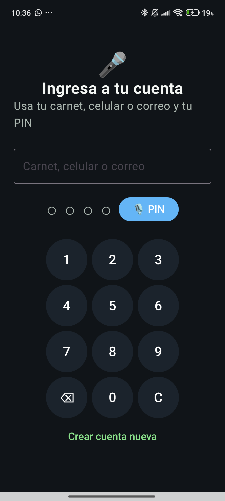

# Bitácora de evidencias y resultados

Registro incremental. Cada entrada distingue comprobaciones técnicas, pruebas automatizadas y pruebas funcionales. No se infieren resultados de un commit ni se inventan evidencias.

## Historial previo: funcionalidades y validaciones técnicas

- **Fecha:** anterior al 2026-11-10; fecha exacta no conservada.
- **Trabajo implementado:** ventas locales con persistencia transaccional de venta, stock y Outbox; rechazo de stock negativo; autenticación API separada del PIN local; sincronización de catálogo paginada; voz que propone datos pero requiere confirmación; deduplicación de productos de plantilla; y pantalla de reportes diarios.
- **Validaciones técnicas reportadas en la sesión previa:** build backend, chequeo de tipos, 8 pruebas unitarias, 6 pruebas de integración PostgreSQL y compilación Android debug finalizaron correctamente.
- **Límite de esta constancia:** no se conservaron el enlace de CI, la fecha exacta ni los logs primarios. Es un antecedente de trabajo, no evidencia de GitHub Actions ni prueba funcional manual. Las pruebas funcionales de Android permanecen pendientes de capturas.

## Fase 0: Evidencia visual del login Android

- **Fecha:** 2026-11-10
- **Qué se probó:** se lanzó la app en un dispositivo Android conectado y se capturó la pantalla de login inicial.
- **Resultado observado:** la pantallla de acceso cargó correctamente con el campo de carnet/celular/correo y la entrada del PIN con el botón de micrófono; la captura confirma la UI pero no la validación del dictado ni el acceso real del usuario.
- **Evidencia:** 
- **Estado:** evidencia de interfaz disponible; la validación funcional completa del PIN por voz y el acceso con credenciales sigue pendiente.

## Fase 0b: Plantilla de captura para login y registro

- **Qué se necesita:** grabar la prueba funcional completa de login con PIN local y de registro persistido en PostgreSQL.
- **Regla de integridad:** no se marca aprobada la prueba funcional de Android sin una captura o video en `docs/evidencias/`. Se usa la siguiente plantilla solo como referencia para insertar la evidencia real cuando exista.
- **Markdown a insertar una vez se disponga de la captura real:**

```markdown


```

- **Estado actual:** las capturas `login_exitoso.png` y `registro_en_postgres.png` siguen pendientes; no se publican como evidencia aunque el flujo haya sido implementado y se haya validado la compilación.

## Fase 1: Cambios Android recientes

- **Fecha:** 2026-11-10
- **Qué se hizo:** se integraron el reporte diario, navegación desde el asistente de voz al formulario con sugerencias y la deduplicación de productos de plantilla.
- **Comprobación técnica:** `:app:assembleDebug` finalizó correctamente durante la validación del cambio. Esto solo confirma compilación; no confirma el comportamiento en un dispositivo.
- **Resultado funcional:** PENDIENTE de prueba manual y captura/video.
- **Evidencia:** pendiente; guardar en `evidencias/03_dashboard/`, `evidencias/04_ventas/` o `evidencias/06_chat_ia/` según el caso.

## Fase 2: Argumentos tipados para venta sugerida por voz

- **Fecha:** 2026-11-10
- **Qué se cambió:** el destino de venta recibe `producto` codificado y `cantidad` como texto numérico; la cantidad se valida y convierte a `Double` al entrar porque Navigation 2.8.3 no expone `NavType.DoubleType`. El formulario solo selecciona coincidencias normalizadas exactas.
- **Comprobación técnica:** `:app:assembleDebug` finalizó correctamente; la compilación no valida el flujo en un dispositivo.
- **Resultado funcional:** PENDIENTE de probar el dictado, confirmar el producto/cantidad y guardar evidencia en `evidencias/06_chat_ia/` y `evidencias/04_ventas/`.

## Fase 3: Backend - build, tipos y pruebas unitarias locales

- **Fecha:** 2026-11-10
- **Qué se probó:** desde `backend/`, se ejecutaron `npm run build`, `npm run typecheck:test` y `npm test`.
- **Resultado obtenido:** build correcto, chequeo de tipos correcto y 8 pruebas unitarias aprobadas (8 pasaron, 0 fallaron).
- **Alcance:** ejecución local en el commit `c187bba`; no es una ejecución de GitHub Actions.
- **Evidencia:** salida de consola observada en esta sesión; enlazar el workflow cuando se ejecute en GitHub. No hay captura añadida aún.

## Fase 4: Backend - pruebas de integración PostgreSQL

- **Fecha:** 2026-11-10
- **Qué se probó:** intento de preparar/migrar la base de pruebas local para ejecutar `npm run test:integration`.
- **Resultado obtenido:** BLOQUEADO; PostgreSQL rechazó la autenticación para el usuario `mypes_test`. No se pudo confirmar el resultado de integración local.
- **Acción pendiente:** ejecutar el workflow, que configura un PostgreSQL temporal con credenciales de prueba aisladas, y registrar su resultado real.
- **Evidencia:** pendiente; enlazar el workflow o guardar una captura anonimizada en `evidencias/08_backend/`.

## Fase 5: Pruebas funcionales en dispositivo

- **Fecha:** pendiente
- **Qué se probó:** pendiente de confirmación por el equipo.
- **Resultado obtenido:** PENDIENTE. No hay capturas/videos confirmados en `evidencias/`.
- **Evidencia:** añadir una entrada por escenario solo después de ejecutar la prueba y guardar su captura/video.

## Fase 6: Pruebas unitarias JVM de NLU y PIN

- **Fecha:** 2026-11-10
- **Qué se probó:** `:app:testDebugUnitTest` con extracción de entidades (incluye "cuartillas", montos en bolivianos y "al fiado"), clasificación de intención de venta y hashing PBKDF2 del PIN.
- **Resultado obtenido:** 5 pruebas reportadas por JUnit XML; 5 pasaron, 0 fallaron, 0 errores y 0 omitidas. Suites: 2 de extracción, 1 de clasificación y 2 de hash/PIN. Los resultados están en `mobile/app/build/test-results/testDebugUnitTest/`.
- **Alcance:** pruebas JVM locales; validan componentes aislados, no reconocimiento acústico en un dispositivo ni la UI de sincronización. `:app:assembleDebug` también terminó correctamente.
- **Evidencia:** reportes XML locales; las capturas indicadas por el equipo se agregarán tras obtenerlas.

## Fase 7: Pantalla de sincronización conectada al Outbox

- **Qué se verificó:** la pantalla observa las operaciones `PENDIENTE` y errores desde Room y presenta el conteo, los IDs abreviados y los intentos; el botón conserva la lógica existente de vinculación de cuenta y WorkManager.
- **Estado técnico:** `:app:assembleDebug` finalizó correctamente y generó el APK debug.
- **Resultado funcional:** PENDIENTE de verificar en el dispositivo y guardar `evidencias/07_sincronizacion/pantalla_sync_real.png`.
- **Límite:** no se creó una captura ni se declaró aprobada la prueba de UI.

## Fase 8: Corrección del wrapper de Gradle en Windows

- **Qué se corrigió:** `mobile/gradlew.bat` devolvía código 1 incluso si Gradle terminaba correctamente, lo que hacía que automatizaciones interpretaran falsamente como fallida una compilación exitosa.
- **Resultado obtenido:** se verificó `gradlew.bat --version` con código 0 y se ejecutaron las pruebas JVM y el APK con `BUILD SUCCESSFUL`, código 0.
- **Alcance:** el wrapper preserva éxito y fallo de Gradle para que CI local y scripts de Windows puedan interpretar el resultado.

## Fase 9: Gráfico semanal y vista de demostración del reporte

- **Fecha:** 2026-11-10
- **Qué se implementó:** el reporte consulta los totales de cada uno de los últimos siete días mediante intervalos locales `[inicio, fin)`. Se añadió una vista demostrativa solo para builds debug; sus cifras ficticias afectan únicamente al gráfico y no se persisten. El selector de compartir sigue usando el total real del día.
- **Comprobación técnica:** `:app:testDebugUnitTest :app:assembleDebug` finalizó con código 0 usando JBR 21 y el SDK Android instalado. JUnit reportó 5 pruebas, 0 fallos, 0 errores y 0 omitidas; el APK debug se compiló correctamente.
- **Resultado funcional:** PENDIENTE de validar el gráfico, el cambio de día, el selector de compartir y la separación entre datos demo y reales en un dispositivo.
- **Plan asociado:** `DASH-03`, `DASH-04` y `DASH-05` permanecen PENDIENTES hasta contar con esa validación.
- **Evidencia:** reportes JUnit locales en `mobile/app/build/test-results/testDebugUnitTest/`; captura funcional pendiente en `evidencias/03_dashboard/`.

## Fase 10: Registro local y alta de cuenta en backend

- **Fecha:** 2026-11-10
- **Qué se implementó:** formulario de registro Android con datos personales, negocio, PIN y contraseña de nube; migración Room 2→3 con columnas de perfil opcionales para conservar usuarios existentes; endpoint `POST /api/v1/auth/register` con validación, hash scrypt, transacción PostgreSQL para negocio/propietario y token Bearer. La contraseña de nube no se persiste en el dispositivo. Si la red falla, se puede continuar explícitamente con el perfil local y vincular la cuenta después.
- **Comprobaciones backend:** `npm run build`, `npm run typecheck:test` y `npm test` pasaron (8 pruebas unitarias). En una base PostgreSQL temporal y aislada se aplicaron las migraciones 001–004 y `npm run test:integration` pasó (8 pruebas, 0 fallos), incluyendo registro exitoso, acceso con el token, correo duplicado sin negocio huérfano y rechazo de datos incompletos.
- **Comprobaciones Android:** `:app:testDebugUnitTest :app:assembleDebug` pasó (5 pruebas, 0 fallos) con Java 21 y el SDK local.
- **Resultado funcional Android:** PENDIENTE de completar el registro en un dispositivo y probar conexión, modo offline y migración de una base existente.
- **Evidencia:** resultados automatizados locales; capturas pendientes en `evidencias/01_login/` o `evidencias/08_backend/`. No se usaron datos reales.

## Fase 11: Instalación local del modelo de voz Vosk

- **Fecha:** 2026-11-10
- **Qué se hizo:** se descargó el modelo pequeño de español Vosk 0.42 desde su origen oficial y se extrajo en `mobile/app/src/main/assets/vosk-model-small-es-0.42/`. Se añadió `mobile/download-vosk-model.ps1` para instalarlo en otras máquinas y se comprobó su comportamiento idempotente.
- **Comprobación técnica:** el APK debug se compiló con el modelo y contiene `assets/vosk-model-small-es-0.42/am/final.mdl`. Su tamaño resultó de 117,392,971 bytes; el modelo permanece excluido de Git, por lo que cada equipo debe ejecutar el script antes de compilar.
- **Resultado funcional:** PENDIENTE de inicializar Vosk y dictar una frase en un dispositivo; la presencia del modelo en el APK no prueba el reconocimiento acústico.
- **Evidencia:** compilación local; captura de reconocimiento pendiente en `evidencias/06_chat_ia/`.

## Fase 12: Pantalla de perfil del comerciante

- **Fecha:** 2026-11-10
- **Qué se implementó:** ruta `perfil` accesible desde el icono del encabezado del dashboard y pantalla de solo lectura que consulta el registro local Room fuera del hilo principal. Muestra los datos personales y del negocio, con estado de carga/error y un texto explícito para campos opcionales no registrados; no muestra PIN, hash ni sal.
- **Comprobación técnica:** `:app:testDebugUnitTest :app:assembleDebug` finalizó con código 0 tras incorporar la pantalla.
- **Resultado funcional:** PENDIENTE de registrar un perfil y verificar su visualización en dispositivo; no se declara APROBADO sin evidencia.
- **Evidencia:** pendiente en `evidencias/01_login/perfil_usuario.png`.
- **Prueba de backend relacionada:** `backend/test/integration/auth-registration.test.ts` ya valida el alta del negocio/propietario, lectura persistida, JWT utilizable, rechazo de campos incompletos y duplicados. No se creó el archivo de prueba duplicado propuesto.

## Fase 13: Fiados, búsqueda y exportación CSV

- **Fecha:** 2026-11-10
- **Qué se implementó:** Room v4 añade `ventas.pagado` con migración 3→4 y valor inicial falso para conservar las deudas antiguas. La pantalla Fiados lista ventas fiadas pendientes y pide confirmación de cobro completo. El estado pagado, el ingreso de caja y el evento `COBRO` del Outbox se guardan atómicamente; el mismo `operationId` se sincroniza idempotentemente. Inventario filtra por nombre en tiempo real. El reporte exporta las ventas de hoy a CSV, escapa campos y comparte el archivo desde un `FileProvider` restringido al subdirectorio de reportes de caché.
- **Comprobaciones Android:** `:app:testDebugUnitTest :app:assembleDebug` finalizó correctamente; 7 pruebas JVM, 0 fallos, incluidos casos de formato/escape CSV. Room generó el esquema versión 4.
- **Comprobaciones backend:** build y chequeo de tipos correctos; migraciones y `npm run test:integration` contra PostgreSQL temporal pasaron con 9 pruebas, 0 fallos, incluida la aceptación e idempotencia de `COBRO`.
- **Alcance pendiente:** no se ejecutó en dispositivo la migración de una base real versión 3, el cobro transaccional Room, búsqueda en pantalla ni el envío del URI CSV a otra app. Esas pruebas funcionales siguen PENDIENTES; no se declara probado el ciclo completo en interfaz.
- **Evidencia:** reportes automatizados locales; capturas pendientes en `evidencias/09_fiados/`, `evidencias/05_inventario/` y `evidencias/03_dashboard/`.

## Fase 14: Perfil personal ampliado, login por identificador y PIN por voz

- **Fecha:** 2026-11-10
- **Qué se implementó:** Room v6 conserva los campos anteriores y añade nombres, apellidos, expedición y datos de nacimiento; el login local busca por carnet, celular o correo y ya no crea una cuenta al introducir un PIN en una base vacía. Se añadió extracción unitaria de cuatro dígitos hablados. Registro envía los datos del perfil al backend; la contraseña se almacena como hash scrypt en PostgreSQL y no se conserva en Room. El onboarding guarda nombre/rubro localmente y los actualiza en el negocio asociado al token. Si el registro fue offline, Sincronización permite volver a ingresar correo/contraseña para crear la cuenta con el perfil local.
- **Android:** `:app:testDebugUnitTest :app:assembleDebug` finalizó correctamente con SDK explícito. JUnit reportó 9 pruebas, 0 fallos, 0 errores y 0 omitidas. La prueba incluye extracción de PIN hablado y casos ambiguos. La compilación no valida el flujo ni la migración Room en un dispositivo.
- **Backend:** `npm run build`, `npm run typecheck:test` y `npm test` finalizaron correctamente; 8 pruebas unitarias pasaron. `npm run test:integration` terminó con 10 fallos y 0 aprobadas porque PostgreSQL rechazó la autenticación para `mypes_local`; Docker Desktop tampoco estaba disponible para iniciar la base temporal. La migración 005 y el endpoint de actualización del negocio no se verificaron contra PostgreSQL; REG-08 queda BLOQUEADO.
- **Estado funcional Android:** PENDIENTE de ejecutar login por identificador/voz, registro, onboarding y migración 4→6 en dispositivo. No se generó captura/video ni se marca ninguna prueba funcional como aprobada.
- **Evidencia:** reportes JUnit locales en `mobile/app/build/test-results/testDebugUnitTest/`; captura funcional pendiente en `evidencias/01_login/`, `evidencias/02_onboarding/` y `evidencias/06_chat_ia/`.

## Plantilla para nuevas ejecuciones

### Fase [n]: [módulo y escenario]

- **Fecha:**
- **Commit / versión:**
- **Qué se probó:**
- **Entorno y datos de prueba:**
- **Resultado esperado:**
- **Resultado obtenido:**
- **Estado:** PENDIENTE / APROBADO / FALLIDO / BLOQUEADO
- **Evidencia:** `evidencias/[carpeta]/[archivo]` o enlace al workflow de GitHub Actions.
