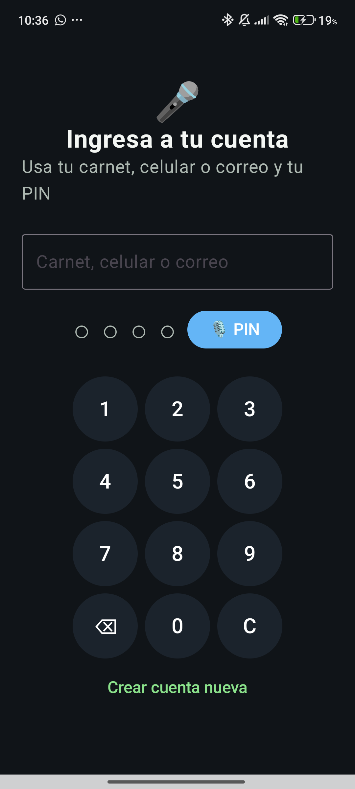
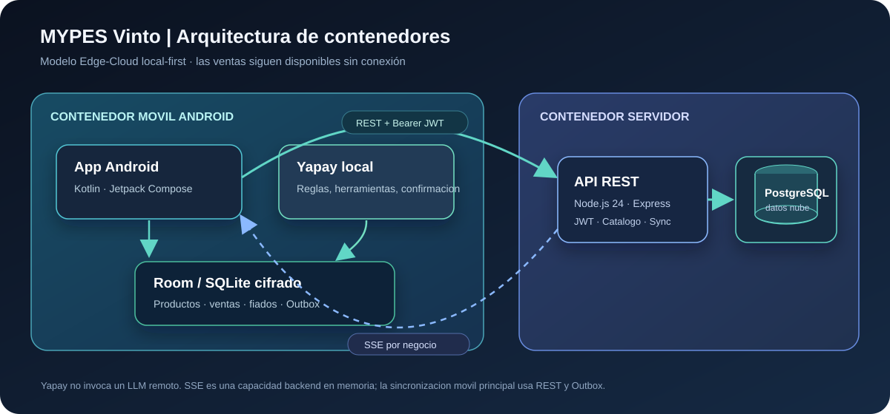
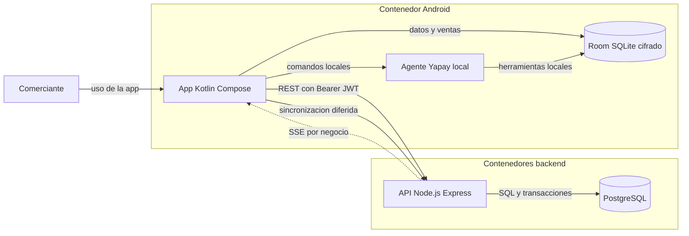
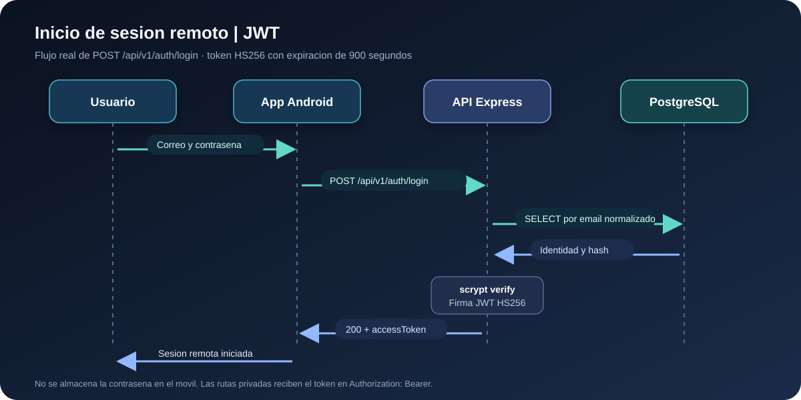
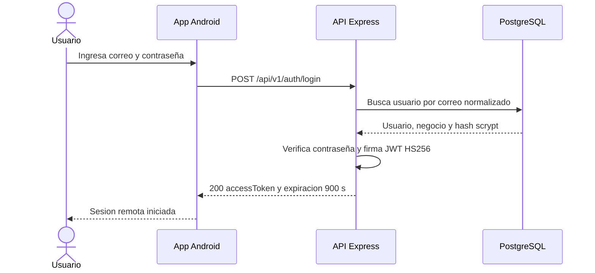

# Informe técnico de segunda presentación

## Asistente conversacional offline para MYPES de Vinto

**Universidad Adventista de Bolivia · Ingeniería en Sistemas · Tecnologías en Internet**

| Control del documento | Detalle |
|---|---|
| Entrega | Segunda presentación del proyecto integrador |
| Versión documental | 1.0 |
| Fecha de corte técnico | 13 de noviembre de 2026 |
| Equipo | Eva Lizeth Chino Quispe, Christian Gonzales Mamani, Marializ Mamani Quispe, Kevin Jhonathan Rocha Rojas y Luis Gerardo Lazo Bustamante |
| Docente | Por completar con el dato oficial de la asignatura |
| Repositorio | [bibi567-ch/asistente-ia-mypes-vinto](https://github.com/bibi567-ch/asistente-ia-mypes-vinto) |
| Revisión de código documentada | `03afcbd` |

> **Alcance de este informe.** Describe el código y la evidencia disponibles en la revisión indicada. Distingue lo implementado de lo probado y de lo que todavía debe demostrarse. No constituye una certificación académica ni una declaración de disponibilidad para producción.

## Índice

1. [Resumen ejecutivo y necesidad](#1-resumen-ejecutivo-y-necesidad)
2. [Alcance y estado funcional](#2-alcance-y-estado-funcional)
3. [Trazabilidad de requisitos](#3-trazabilidad-de-requisitos)
4. [Arquitectura del sistema](#4-arquitectura-del-sistema)
5. [Persistencia y decisión tecnológica](#5-persistencia-y-decisión-tecnológica)
6. [API REST](#6-api-rest)
7. [Configuración local](#7-configuración-local)
8. [Pruebas y evidencia](#8-pruebas-y-evidencia)
9. [Brechas académicas y acciones](#9-brechas-académicas-y-acciones)
10. [Conclusiones y trabajo futuro](#10-conclusiones-y-trabajo-futuro)

## 1. Resumen ejecutivo y necesidad

Las MYPES necesitan registrar ventas y consultar existencias con una interacción sencilla, incluso cuando la conexión a Internet no está disponible. Este proyecto aborda esa necesidad como un **prototipo móvil local-first** para negocios de Vinto: la operación diaria se guarda primero en el teléfono y la información pendiente se envía al servidor cuando se cumplen las condiciones de conexión y autenticación.

La aplicación Android reúne registro local, inventario, ventas manuales, consulta de fiados, reportes y asistencia de voz en español. La voz depende del modelo Vosk instalado; la interpretación y Yapay utilizan lógica Kotlin basada en reglas. Yapay puede consultar el total diario y preparar un alta de producto, pero pide confirmación y **no es un modelo de lenguaje generativo**.

El backend Node.js/TypeScript/Express ofrece autenticación remota, catálogo por negocio, recepción idempotente de operaciones y prototipos de factura, QR y eventos SSE. El backend recibe eventos de sincronización: no administra un libro completo de ventas ni los saldos de fiados. El PDF de factura es simulado y no tiene validez fiscal.

La necesidad de operar con conectividad intermitente es el supuesto de diseño del proyecto; este informe no la presenta como resultado de un estudio de campo. Las pruebas de usabilidad, rendimiento y aceptación con comerciantes siguen pendientes.



La imagen documenta la carga de la pantalla inicial; no demuestra que el PIN, el registro remoto o la sincronización hayan sido probados. Los diagramas son representaciones de arquitectura, no evidencia de una ejecución integral.

## 2. Alcance y estado funcional

La solución incluye Kotlin, Jetpack Compose, Room/SQLite con SQLCipher y un backend Node.js 24, TypeScript, Express y PostgreSQL. **Android es el cliente existente; no hay una aplicación web React en este alcance.**

| Capacidad | Estado en el código | Evidencia y límite |
|---|---|---|
| Perfil y acceso local mediante identificador y PIN | Implementado | El PIN se deriva con PBKDF2-HMAC-SHA256. La prueba funcional completa en dispositivo sigue pendiente. |
| Acceso a la API | Implementado por separado del PIN local | Usa correo/contraseña y JWT. La contraseña remota se almacena como hash scrypt; el flujo móvil end-to-end aún requiere evidencia. |
| Inventario | Persistencia local y API con consulta/alta/edición/borrado | El catálogo remoto se descarga; los productos creados solo en el teléfono no se suben automáticamente. |
| Ventas y fiados | Registro local, actualización de existencias y cola Outbox | La recepción remota conserva eventos idempotentes, no un saldo de deuda remoto. Falta prueba integral en dispositivo. |
| Voz y Yapay | Reconocimiento Vosk y reglas Kotlin, con confirmación humana | No se encontró un clasificador TFLite activo ni un LLM conectado. Reconocimiento y calidad acústica no están validados en dispositivo. |
| Factura, QR y SSE | Endpoints de backend | No hay un flujo Android integral verificado; la factura es simulada y SSE opera en memoria por instancia. |

La autenticación de la API utiliza JWT HS256 con vigencia de 15 minutos. El backend aísla los datos por `business_id`; aunque la tabla contemple roles, hoy no hay permisos diferenciados por rol. La implementación no tiene mediciones publicadas de carga, latencia, accesibilidad ni usabilidad.

## 3. Trazabilidad de requisitos

| ID | Requisito funcional | Frontend Android | Endpoint backend relacionado | Estado y límite |
|---|---|---|---|---|
| RF-001 | Registrar propietario e iniciar sesión | `RegistroScreen`, `LoginScreen` y `ApiLoginScreen` | `POST /api/v1/auth/register`, `POST /api/v1/auth/login` | Implementado; el PIN local y la contraseña/JWT de nube son mecanismos separados. |
| RF-002 | Consultar y administrar productos | `InventarioScreen` | `GET` y `POST /api/v1/products`; `PUT` y `DELETE /api/v1/products/:id` | API protegida por negocio. La ruta de sincronización de catálogo es `GET /api/v1/products/sync`. |
| RF-003 | Registrar ventas al contado o fiadas y consultar deuda local | `VentaManualScreen`, `FiadosScreen` | `POST /api/v1/transacciones/batch` | La venta y el saldo fiado se mantienen en Room; el backend acepta eventos idempotentes, no administra el saldo de deuda remoto. |
| RF-004 | Operar offline y sincronizar al recuperar conectividad | `SincronizacionScreen` y trabajo diferido | `POST /api/v1/transacciones/batch`, `GET /api/v1/products/sync` | Implementado mediante Outbox/WorkManager y REST. SSE existe en el backend, pero no sustituye el flujo móvil paginado ni cuenta con una integración Android demostrada. |
| RF-005 | Preparar una factura de prueba y guardar el QR del negocio | No hay una pantalla Android conectada a estos endpoints en el alcance verificado | `POST /api/v1/facturas`, `POST /api/v1/qr` | Prototipo backend. El PDF es simulado/no fiscal; no hay integración con el SIN ni flujo de QR verificado desde Android. |

Los requisitos no funcionales se abordan con decisiones concretas, pero no todos tienen mediciones de aceptación. El acceso a rutas privadas requiere JWT firmado con HS256 y vigencia de 15 minutos; las contraseñas remotas se almacenan con scrypt y comparación en tiempo constante, y el backend exige un secreto de firma de al menos 32 bytes. Las consultas y escrituras de productos/transacciones se limitan al `business_id` del token. La interfaz local-first reduce la dependencia de la red durante ventas, y los listados y lotes tienen límites de tamaño. No se han publicado pruebas de carga ni objetivos cuantificados de latencia. Aunque la tabla `users` contempla `owner` y `staff`, no existe autorización diferenciada por rol en las rutas actuales: la autorización efectiva es por token y ámbito del negocio.

## 4. Arquitectura del sistema

La vista C4 de contenedores resume los límites de ejecución y persistencia. Yapay reside dentro del cliente Android y opera localmente; no se dibuja un proveedor LLM porque no hay uno conectado.



<!-- mermaid-checked: no \n, no em-dash/en-dash, no {} in labels, subgraphs are id["label"], arrows are -->|"label"|, all subgraphs closed by end, ids unique -->


La secuencia muestra el inicio de sesión remoto. El token es firmado por la API después de consultar al propietario y verificar el hash scrypt; el servidor lo devuelve a la app, que lo presenta como Bearer en llamadas protegidas.





## 5. Persistencia y decisión tecnológica

Se utilizan dos almacenes con responsabilidades distintas: Room/SQLite cifrado en el teléfono conserva los datos necesarios para operar sin conexión; PostgreSQL en el servidor gestiona cuentas, negocios, catálogo y recepción de eventos de sincronización. No se usa MongoDB en esta implementación.

### Justificación de PostgreSQL y decisión sobre MongoDB/Mongoose

El modelo actual relaciona propietarios, negocios, productos y operaciones que representan dinero. PostgreSQL permite expresar estas relaciones mediante claves foráneas, restricciones, transacciones y tipos decimales. Las restricciones únicas por negocio y `operation_id` apoyan la idempotencia de la sincronización. Estas características ayudan a conservar la integridad, pero no sustituyen la validación de reglas, las copias de seguridad ni las pruebas.

MongoDB también admite transacciones en configuraciones compatibles; por ello, la decisión **no** se fundamenta en afirmar que una base documental carezca de consistencia. Se tomó porque el dominio y el esquema ya implementado son relacionales, las migraciones y las pruebas existentes usan SQL, y el producto no presenta una necesidad documentada que justifique operar dos modelos de persistencia. Añadir MongoDB/Mongoose solo para duplicar los mismos datos aumentaría el trabajo de sincronización, mantenimiento y pruebas sin mejorar el flujo principal.

Esta decisión técnica no equivale a cumplir un requisito académico de MongoDB/Mongoose. Si la rúbrica exige demostrar esa tecnología, se debe acordar con la docente el artefacto que acepta (por ejemplo, una práctica didáctica acotada y separada) o aprobar explícitamente una modificación del alcance. No se debe cambiar la base central ni mantener escritura duplicada sin una decisión arquitectónica, reglas de consistencia y pruebas.

| Entidad o tabla | Almacén | Datos y propósito |
|---|---|---|
| `users` | PostgreSQL | Cuenta, email normalizado, hash de contraseña, rol declarado y referencia al negocio. |
| `businesses` | PostgreSQL | Identidad y perfil del negocio al que se aísla el catálogo y la sincronización. |
| `products` | PostgreSQL | Catálogo remoto con unidad, precio decimal, fechas e identidad del negocio. |
| `ventas` | Room/SQLite | Venta local, total, forma de pago, cliente fiado, estado de pago y fecha. No existe una tabla `ventas` equivalente en las migraciones actuales de PostgreSQL. |
| `transacciones` | PostgreSQL | Bandeja de operaciones sincronizadas: tipo, payload JSONB, total, forma de pago y resultado. Incluye eventos `VENTA`, `COMPRA`, `FIADO` y `COBRO`; no es un libro remoto completo de saldos. |
| `sync_operations` | PostgreSQL | Registro de operaciones recibidas y su estado de procesamiento. |
| `conflictos` | PostgreSQL | Registro de conflictos detectados durante la sincronización. |
| `invoices` | PostgreSQL | Datos y total de facturas de prueba; el PDF devuelto es simulado. |
| `business_payment_qr` | PostgreSQL | Un QR Base64 por negocio, reemplazable al actualizarse. |
| `outbox`, `detalle_ventas`, `movimientos_caja` | Room/SQLite | Cola local, líneas de venta y movimientos de caja. La base Room usa SQLCipher. |

Los índices y restricciones relevantes incluyen `UNIQUE (business_id, name)` en productos, `UNIQUE (business_id, operation_id)` en transacciones e inbox de sincronización, `UNIQUE` en el email de usuario, e índices por negocio/fecha para catálogo, transacciones y facturas. En Room, Outbox tiene índice único por `operationId`; los detalles de venta tienen índices por venta y producto. El endpoint de sincronización procesa lotes de hasta 100 operaciones y maneja reintentos de forma idempotente.

## 6. API REST

Todas las rutas usan el prefijo `/api/v1`. Los nombres de rutas que siguen corresponden a `backend/src/app.ts` y a los routers actuales. `Authorization: Bearer <JWT>` es obligatorio donde se indica. El backend no aplica permisos diferenciados por rol; las rutas privadas requieren un token válido y limitan datos al negocio incluido en sus claims.

| Método | Ruta real | Autenticación | Respuesta de éxito | Otros códigos observados | Función |
|---|---|---|---|---|---|
| GET | `/api/v1/health` | No | `200` | `503` si PostgreSQL no está disponible | Estado del servicio. |
| POST | `/api/v1/auth/register` | No | `201` | `400`, `409`, `500` | Crea propietario y negocio; devuelve JWT. |
| POST | `/api/v1/auth/login` | No | `200` | `400`, `401`, `500` | Verifica email/contraseña y devuelve JWT de 15 minutos. |
| PUT | `/api/v1/auth/business` | Bearer JWT | `204` | `400`, `401`, `404`, `500` | Actualiza el perfil del negocio del token. |
| POST | `/api/v1/auth/change-password` | Bearer JWT | `204` | `400`, `401`, `500` | Cambia contraseña verificando la actual. |
| GET | `/api/v1/products` | Bearer JWT | `200` | `400`, `401`, `500` | Lista productos del negocio con paginación. |
| POST | `/api/v1/products` | Bearer JWT | `201` | `400`, `401`, `409`, `500` | Crea producto en el negocio autenticado. |
| PUT | `/api/v1/products/:id` | Bearer JWT | `200` | `400`, `401`, `404`, `500` | Actualiza nombre, unidad y precio. |
| DELETE | `/api/v1/products/:id` | Bearer JWT | `204` | `401`, `404`, `500` | Elimina producto del negocio autenticado. |
| GET | `/api/v1/products/sync` | Bearer JWT | `200` | `400`, `401`, `500` | Devuelve catálogo modificado desde un cursor/fecha. |
| POST | `/api/v1/transacciones/batch` | Bearer JWT | `200` | `400`, `401`, `500` | Recibe lote de operaciones offline idempotentes. |
| POST | `/api/v1/facturas` | Bearer JWT | `201` | `400`, `401`, `500` | Guarda factura de prueba y responde con PDF Base64 simulado. |
| POST | `/api/v1/qr` | Bearer JWT | `200` | `400`, `401`, `500` | Crea o reemplaza el QR de pago del negocio. |
| GET | `/api/v1/sync/updates` | Bearer JWT | `200` SSE | `401` | Canal SSE en memoria con eventos del negocio autenticado. |

**Aclaración de rutas solicitadas:** el código monta productos en `/api/v1/products`, por lo que PUT y DELETE requieren `/:id`; no son `PUT /api/v1/products` ni `DELETE /api/v1/products`. Las rutas cloud se montan directamente bajo `/api/v1`: son `/api/v1/facturas` y `/api/v1/qr`, no `/api/v1/cloud/facturas` ni `/api/v1/cloud/qr`. La ruta de SSE real es `/api/v1/sync/updates`. No se documentan como existentes endpoints que no están registrados.

## 7. Configuración local

Ejemplo local basado en las variables que valida el backend. Los valores marcados para reemplazo son placeholders, no credenciales para publicar ni usar en producción.

```dotenv
NODE_ENV=development
HOST=127.0.0.1
PORT=3000
DATABASE_URL=postgres://<usuario_local>:<clave_local>@127.0.0.1:5432/mypes_vinto_dev
JWT_SECRET=<secreto_aleatorio_de_al_menos_32_bytes>
```

| Variable | Propósito |
|---|---|
| `NODE_ENV` | Entorno de ejecución; por defecto `development`. |
| `HOST` | Interfaz de red donde escucha el servicio; por defecto `127.0.0.1` para desarrollo local. |
| `PORT` | Puerto HTTP; por defecto `3000`, debe estar entre 1 y 65535. |
| `DATABASE_URL` | Cadena de conexión a PostgreSQL; el backend exige que esté configurada. |
| `JWT_SECRET` | Clave de firma HS256; el proceso no inicia si tiene menos de 32 bytes. Debe generarse localmente y mantenerse fuera de Git. |

Para crear un secreto de desarrollo en PowerShell, puede usarse `node -e "process.stdout.write(require('node:crypto').randomBytes(32).toString('base64url'))"` y copiar el resultado únicamente al `.env` local. El archivo `backend/.env` no debe incluirse en commits ni compartirse.

## 8. Pruebas y evidencia

El estado de cada prueba se clasifica por el tipo de comprobación: la presencia de código indica implementación; una prueba automatizada cubre los casos programados; una prueba funcional requiere ejecutar la interfaz en el dispositivo previsto y conservar evidencia verificable.

| Área | Resultado disponible al corte | Lo que no demuestra |
|---|---|---|
| Backend | [GitHub Actions, run 43157514411](https://github.com/bibi567-ch/asistente-ia-mypes-vinto/actions/runs/43157514411): instalación, migraciones, build, typecheck, pruebas unitarias e integración completadas con éxito en `main`, revisión `03afcbd`. | No prueba la app Android, el teléfono físico, el despliegue productivo ni funcionalidades que no cubren los casos automatizados. |
| Android | La bitácora registra pruebas JVM y compilaciones debug locales. | No acredita por sí sola el funcionamiento de la interfaz, el micrófono, la migración Room en un dispositivo ni la conexión teléfono–API. |
| Captura de acceso | Se conserva una imagen real de la pantalla inicial. | Confirma la visualización inicial; no comprueba que un PIN haya iniciado sesión ni que el registro remoto haya concluido. |
| Usabilidad, rendimiento y accesibilidad | No hay mediciones consolidadas en esta revisión. | No se deben declarar conformidad WCAG, SUS ≥ 70, latencia ≤ 2 s ni aceptación de comerciantes sin pruebas y resultados correspondientes. |

El detalle de casos, estados y resultados se mantiene en el [plan de pruebas](04_Plan_de_Pruebas.md) y la [bitácora](05_Resultados_de_Pruebas.md). Para reproducir la configuración del backend o preparar Android, consulta la [guía local](06_Guia_de_Despliegue.md).

## Anexo A. Procedimiento de ejecución local

Requisitos: Git, Node.js 24.x, npm y Docker Desktop con Compose. Ejecutar desde PowerShell en un entorno local de desarrollo:

```powershell
git clone https://github.com/bibi567-ch/asistente-ia-mypes-vinto.git
Set-Location asistente-ia-mypes-vinto
docker compose up -d postgres
Copy-Item backend\.env.example backend\.env
$secret = node -e "process.stdout.write(require('node:crypto').randomBytes(32).toString('base64url'))"
(Get-Content backend\.env) -replace '^JWT_SECRET=.*$', "JWT_SECRET=$secret" | Set-Content -Encoding ascii backend\.env
Set-Location backend
npm ci
npm run db:migrate
npm run admin:create-owner -- "MYPE de prueba" "propietario@example.test"
npm run dev
```

El comando de alta imprime una contraseña temporal una sola vez; úsese solo con datos de prueba y no se copie al informe. En otra terminal, comprobar la salud:

```powershell
curl.exe http://127.0.0.1:3000/api/v1/health
```

Para probar la autenticación, envíe `POST http://127.0.0.1:3000/api/v1/auth/login` con `Content-Type: application/json` y el email de prueba más la contraseña temporal obtenida al crear el propietario. Use el `accessToken` devuelto como `Authorization: Bearer <token>` al consultar `GET http://127.0.0.1:3000/api/v1/products`. Para validar automatizadamente el código backend, desde `backend/` se pueden ejecutar `npm run build`, `npm run typecheck:test` y `npm test`; `npm run test:integration` requiere PostgreSQL y migraciones. El arranque local no constituye prueba de producción, y la API no debe exponerse a Internet con esta configuración de desarrollo.

## 9. Brechas académicas y acciones para la presentación

Esta tabla resume los pendientes identificados en la documentación de la entrega. Debe cotejarse con la rúbrica oficial de la asignatura; no la reemplaza.

| Criterio o necesidad | Situación actual | Acción antes de afirmar cumplimiento |
|---|---|---|
| MongoDB/Mongoose | No forman parte del backend actual, que usa PostgreSQL. | Confirmar por escrito con la docente si se requiere una práctica separada o cambiar el alcance. Presentar PostgreSQL como decisión técnica, no como equivalente de MongoDB. |
| Aplicación web | No existe un frontend web en el repositorio; el cliente implementado es Android. | Verificar si la rúbrica exige web. Si es obligatorio, acordar su alcance y responsable; si no, justificar formalmente la aplicación móvil como cliente entregado. |
| Pruebas Android | Hay compilaciones, pruebas JVM y una captura de la pantalla inicial; no hay evidencia funcional integral en teléfono. | Registrar protocolo, dispositivo, datos ficticios, pasos, resultado esperado/observado y capturas anonimizadas para login, onboarding, inventario, venta y operación offline. |
| Voz con Vosk | El código requiere el modelo local; la transcripción acústica no está validada en teléfono. | Instalar el modelo siguiendo la guía móvil y probar en el dispositivo objetivo; no presentar una compilación como prueba de reconocimiento. |
| Sincronización teléfono–API | El backend CI pasa y la app tiene Outbox/WorkManager; falta el recorrido end-to-end con red y token configurados. | Ejecutar una prueba controlada con datos ficticios y documentar request/resultado sin revelar JWT. |
| Seguridad, rendimiento y UX | No hay evidencia de auditoría, prueba de carga, medición de latencia, contraste ni SUS. | Medir cada criterio de la rúbrica con un método reproducible y consignar valores reales; no marcarlo cumplido solo porque aparece en el diseño. |

## 10. Conclusiones y trabajo futuro

La arquitectura local-first responde al objetivo principal del prototipo: mantener en el teléfono las operaciones necesarias para registrar ventas cuando no hay conexión y diferir la comunicación con el backend. Room/SQLite conserva los datos locales; Node.js/TypeScript/Express y PostgreSQL ofrecen autenticación remota, catálogo y recepción de eventos. Yapay y la voz aportan una interacción demostrativa, pero no reemplazan la revisión de la persona ni constituyen un sistema generativo.

La evidencia disponible permite presentar con claridad el estado técnico del backend, no afirmar que todos los criterios académicos o flujos móviles están satisfechos. El siguiente paso prioritario es obtener la decisión docente sobre MongoDB/Mongoose y la aplicación web, y después ejecutar las pruebas móviles pendientes con registros reproducibles y datos ficticios. Cualquier ampliación —roles, SSE distribuido o integración fiscal— debe tratarse como trabajo futuro hasta implementarse y probarse.
