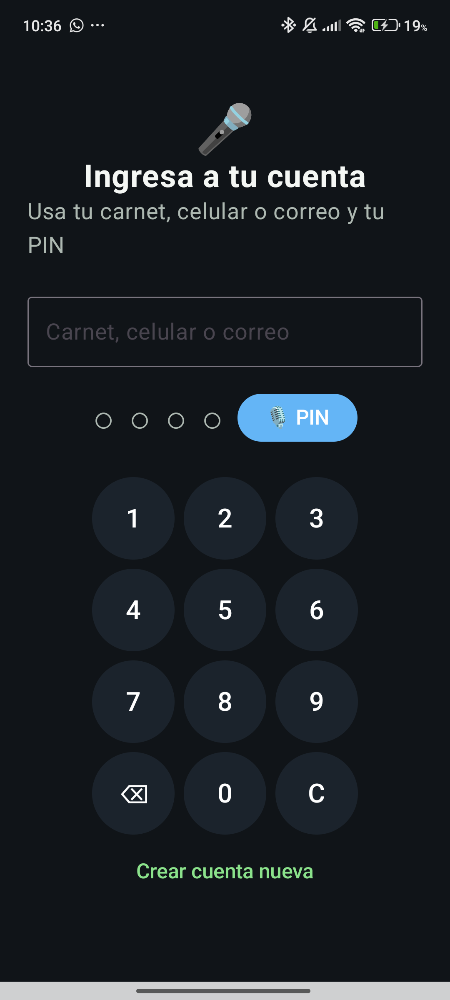
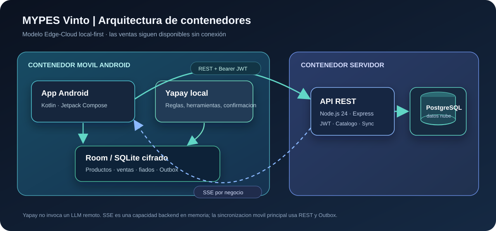
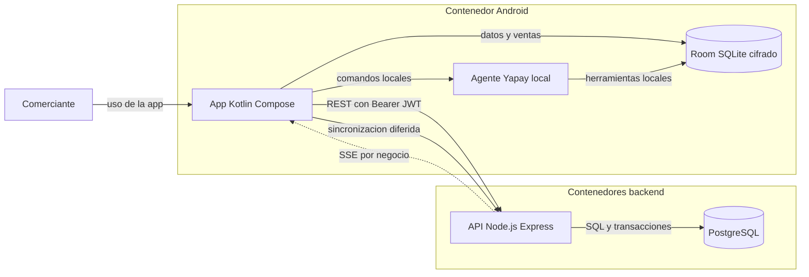
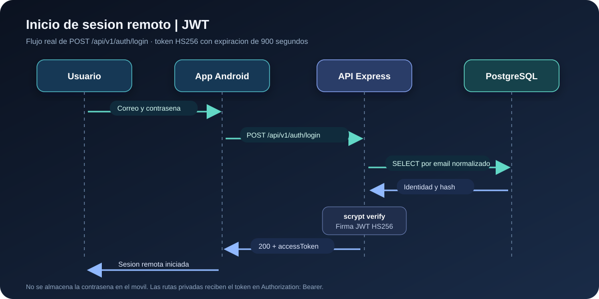
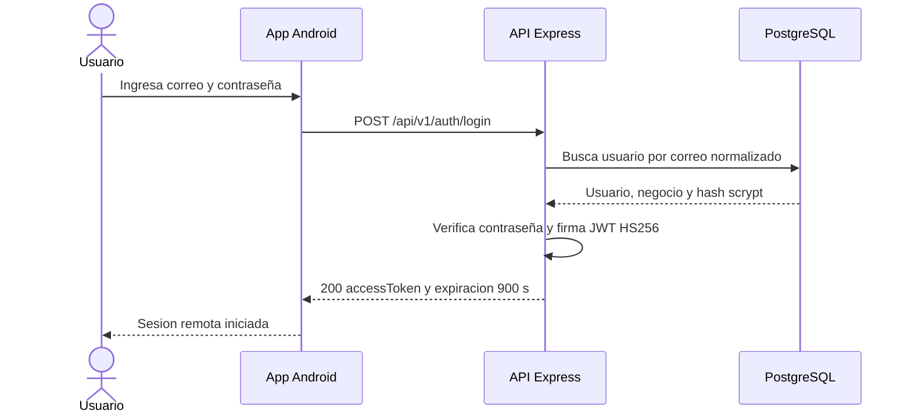

# Informe de Segunda Entrega - Proyecto Integrador

## 1. Carátula e Información General

| Dato | Información |
|---|---|
| Proyecto | Asistente conversacional offline para MYPES de Vinto |
| Entrega | Segunda entrega - Tecnologías en Internet |
| Asignatura | Tecnologías en Internet (TI) |
| Equipo | Eva Lizeth Chino Quispe, Christian Gonzales Mamani, Marializ Mamani Quispe, Kevin Jhonathan Rocha Rojas y Luis Gerardo Lazo Bustamante |
| Fecha | 11 de noviembre de 2026 |
| Repositorio | [GitHub: bibi567-ch/asistente-ia-mypes-vinto](https://github.com/bibi567-ch/asistente-ia-mypes-vinto) |

## 2. Resumen Ejecutivo y Alcance

El proyecto es un prototipo móvil para apoyar la operación diaria de micro y pequeñas empresas del centro de Vinto, Cochabamba. La aplicación Android prioriza el funcionamiento sin conexión: guarda productos, ventas, movimientos y operaciones pendientes localmente; cuando hay conectividad, sincroniza el catálogo y envía el Outbox al backend. Yapay es un asistente local basado en reglas y herramientas de Room; no es una conexión a un modelo de lenguaje remoto. Para las altas que prepara, solicita confirmación antes de guardar.

El alcance implementado incluye autenticación remota con JWT, catálogo de productos con operaciones de consulta/alta/edición/borrado protegidas por negocio, registro local de ventas al contado y fiadas, consulta de fiados, sincronización offline idempotente y un prototipo de facturación que devuelve un PDF explícitamente simulado. La API también conserva un QR de pago por negocio y expone eventos SSE. La factura no está autorizada por el Servicio de Impuestos Nacionales (SIN), y la recepción remota de transacciones conserva eventos de sincronización, no un libro remoto completo de ventas o saldos de deuda.

La app usa Kotlin, Jetpack Compose, Room/SQLite y SQLCipher. El backend usa Node.js 24, TypeScript, Express y PostgreSQL. No hay un frontend React en el alcance actual: el cliente del producto es Android. Un portal web React podría evaluarse como ampliación futura, no como una dependencia existente.

La pantalla de acceso Android mostrada abajo es una captura real incluida en la evidencia del repositorio. Los diagramas de arquitectura y secuencia de este informe son representaciones técnicas, no capturas de una ejecución end-to-end.



## 3. Trazabilidad de Requisitos

| ID | Requisito funcional | Frontend Android | Endpoint backend relacionado | Estado y límite |
|---|---|---|---|---|
| RF-001 | Registrar propietario e iniciar sesión | `RegistroScreen`, `LoginScreen` y `ApiLoginScreen` | `POST /api/v1/auth/register`, `POST /api/v1/auth/login` | Implementado; el PIN local y la contraseña/JWT de nube son mecanismos separados. |
| RF-002 | Consultar y administrar productos | `InventarioScreen` | `GET` y `POST /api/v1/products`; `PUT` y `DELETE /api/v1/products/:id` | API protegida por negocio. La ruta de sincronización de catálogo es `GET /api/v1/products/sync`. |
| RF-003 | Registrar ventas al contado o fiadas y consultar deuda local | `VentaManualScreen`, `FiadosScreen` | `POST /api/v1/transacciones/batch` | La venta y el saldo fiado se mantienen en Room; el backend acepta eventos idempotentes, no administra el saldo de deuda remoto. |
| RF-004 | Operar offline y sincronizar al recuperar conectividad | `SincronizacionScreen` y trabajo diferido | `POST /api/v1/transacciones/batch`, `GET /api/v1/products/sync` | Implementado mediante Outbox/WorkManager y REST. SSE existe en el backend, pero no sustituye el flujo móvil paginado ni cuenta con una integración Android demostrada. |
| RF-005 | Preparar una factura de prueba y guardar el QR del negocio | No hay una pantalla Android conectada a estos endpoints en el alcance verificado | `POST /api/v1/facturas`, `POST /api/v1/qr` | Prototipo backend. El PDF es simulado/no fiscal; no hay integración con el SIN ni flujo de QR verificado desde Android. |

Los requisitos no funcionales se abordan con decisiones concretas, pero no todos tienen mediciones de aceptación. El acceso a rutas privadas requiere JWT firmado con HS256 y vigencia de 15 minutos; las contraseñas remotas se almacenan con scrypt y comparación en tiempo constante, y el backend exige un secreto de firma de al menos 32 bytes. Las consultas y escrituras de productos/transacciones se limitan al `business_id` del token. La interfaz local-first reduce la dependencia de la red durante ventas, y los listados y lotes tienen límites de tamaño. No se han publicado pruebas de carga ni objetivos cuantificados de latencia. Aunque la tabla `users` contempla `owner` y `staff`, no existe autorización diferenciada por rol en las rutas actuales: la autorización efectiva es por token y ámbito del negocio.

## 4. Arquitectura del Sistema

La vista C4 de contenedores resume los límites de ejecución y persistencia. Yapay reside dentro del cliente Android y opera localmente; no se dibuja un proveedor LLM porque no hay uno conectado.



<!-- mermaid-checked: no \n, no em-dash/en-dash, no {} in labels, subgraphs are id["label"], arrows are -->|"label"|, all subgraphs closed by end, ids unique -->


La secuencia muestra el inicio de sesión remoto. El token es firmado por la API después de consultar al propietario y verificar el hash scrypt; el servidor lo devuelve a la app, que lo presenta como Bearer en llamadas protegidas.





## 5. Diseños de Persistencia

Se usan dos almacenes por responsabilidad: Room/SQLite cifrado en el dispositivo para mantener la operación offline y PostgreSQL en el servidor para cuentas, catálogo y recepción de sincronización. No se usa MongoDB en esta implementación.

PostgreSQL es adecuado al dominio porque relaciona propietarios, negocios, productos y operaciones que representan dinero. Sus claves foráneas, restricciones, tipos `NUMERIC`, transacciones SQL y restricciones únicas permiten validar esas relaciones y evitar aceptar dos veces una misma operación por negocio. MongoDB también ofrece transacciones en configuraciones compatibles; la decisión no se basa en afirmar lo contrario, sino en que el modelo actual es relacional, el esquema y las migraciones existentes son SQL y añadir otra base duplicaría modelos, sincronización y pruebas sin una necesidad funcional que lo justifique. Las propiedades ACID ayudan a preservar consistencia, pero no reemplazan validación de reglas, copias de seguridad ni pruebas.

| Entidad o tabla | Almacén | Datos y propósito |
|---|---|---|
| `users` | PostgreSQL | Cuenta, email normalizado, hash de contraseña, rol declarado y referencia al negocio. |
| `businesses` | PostgreSQL | Identidad y perfil del negocio al que se aísla el catálogo y la sincronización. |
| `products` | PostgreSQL | Catálogo remoto con unidad, precio decimal, fechas e identidad del negocio. |
| `ventas` | Room/SQLite | Venta local, total, forma de pago, cliente fiado, estado de pago y fecha. No existe una tabla `ventas` equivalente en las migraciones actuales de PostgreSQL. |
| `transacciones` | PostgreSQL | Bandeja de operaciones sincronizadas: tipo, payload JSONB, total, forma de pago y resultado. Incluye eventos `VENTA`, `COMPRA`, `FIADO` y `COBRO`; no es un libro remoto completo de saldos. |
| `sync_operations` | PostgreSQL | Registro de operaciones recibidas y su estado de procesamiento. |
| `conflictos` | PostgreSQL | Registro de conflictos detectados durante la sincronización. |
| `invoices` | PostgreSQL | Datos y total de facturas de prueba; el PDF devuelto es simulado. |
| `business_payment_qr` | PostgreSQL | Un QR Base64 por negocio, reemplazable al actualizarse. |
| `outbox`, `detalle_ventas`, `movimientos_caja` | Room/SQLite | Cola local, líneas de venta y movimientos de caja. La base Room usa SQLCipher. |

Los índices y restricciones relevantes incluyen `UNIQUE (business_id, name)` en productos, `UNIQUE (business_id, operation_id)` en transacciones e inbox de sincronización, `UNIQUE` en el email de usuario, e índices por negocio/fecha para catálogo, transacciones y facturas. En Room, Outbox tiene índice único por `operationId`; los detalles de venta tienen índices por venta y producto. El endpoint de sincronización procesa lotes de hasta 100 operaciones y maneja reintentos de forma idempotente.

## 6. Especificación de Endpoints y API REST

Todas las rutas usan el prefijo `/api/v1`. Los nombres de rutas que siguen corresponden a `backend/src/app.ts` y a los routers actuales. `Authorization: Bearer <JWT>` es obligatorio donde se indica. El backend no aplica permisos diferenciados por rol; las rutas privadas requieren un token válido y limitan datos al negocio incluido en sus claims.

| Método | Ruta real | Autenticación | Respuesta de éxito | Otros códigos observados | Función |
|---|---|---|---|---|---|
| GET | `/api/v1/health` | No | `200` | `503` si PostgreSQL no está disponible | Estado del servicio. |
| POST | `/api/v1/auth/register` | No | `201` | `400`, `409`, `500` | Crea propietario y negocio; devuelve JWT. |
| POST | `/api/v1/auth/login` | No | `200` | `400`, `401`, `500` | Verifica email/contraseña y devuelve JWT de 15 minutos. |
| PUT | `/api/v1/auth/business` | Bearer JWT | `204` | `400`, `401`, `404`, `500` | Actualiza el perfil del negocio del token. |
| POST | `/api/v1/auth/change-password` | Bearer JWT | `204` | `400`, `401`, `500` | Cambia contraseña verificando la actual. |
| GET | `/api/v1/products` | Bearer JWT | `200` | `400`, `401`, `500` | Lista productos del negocio con paginación. |
| POST | `/api/v1/products` | Bearer JWT | `201` | `400`, `401`, `409`, `500` | Crea producto en el negocio autenticado. |
| PUT | `/api/v1/products/:id` | Bearer JWT | `200` | `400`, `401`, `404`, `500` | Actualiza nombre, unidad y precio. |
| DELETE | `/api/v1/products/:id` | Bearer JWT | `204` | `401`, `404`, `500` | Elimina producto del negocio autenticado. |
| GET | `/api/v1/products/sync` | Bearer JWT | `200` | `400`, `401`, `500` | Devuelve catálogo modificado desde un cursor/fecha. |
| POST | `/api/v1/transacciones/batch` | Bearer JWT | `200` | `400`, `401`, `500` | Recibe lote de operaciones offline idempotentes. |
| POST | `/api/v1/facturas` | Bearer JWT | `201` | `400`, `401`, `500` | Guarda factura de prueba y responde con PDF Base64 simulado. |
| POST | `/api/v1/qr` | Bearer JWT | `200` | `400`, `401`, `500` | Crea o reemplaza el QR de pago del negocio. |
| GET | `/api/v1/sync/updates` | Bearer JWT | `200` SSE | `401` | Canal SSE en memoria con eventos del negocio autenticado. |

**Aclaración de rutas solicitadas:** el código monta productos en `/api/v1/products`, por lo que PUT y DELETE requieren `/:id`; no son `PUT /api/v1/products` ni `DELETE /api/v1/products`. Las rutas cloud se montan directamente bajo `/api/v1`: son `/api/v1/facturas` y `/api/v1/qr`, no `/api/v1/cloud/facturas` ni `/api/v1/cloud/qr`. La ruta de SSE real es `/api/v1/sync/updates`. No se documentan como existentes endpoints que no están registrados.

## 7. Configuración de Entorno

Ejemplo local basado en las variables que valida el backend. Los valores marcados para reemplazo son placeholders, no credenciales para publicar ni usar en producción.

```dotenv
NODE_ENV=development
HOST=127.0.0.1
PORT=3000
DATABASE_URL=postgres://<usuario_local>:<clave_local>@127.0.0.1:5432/mypes_vinto_dev
JWT_SECRET=<secreto_aleatorio_de_al_menos_32_bytes>
```

| Variable | Propósito |
|---|---|
| `NODE_ENV` | Entorno de ejecución; por defecto `development`. |
| `HOST` | Interfaz de red donde escucha el servicio; por defecto `127.0.0.1` para desarrollo local. |
| `PORT` | Puerto HTTP; por defecto `3000`, debe estar entre 1 y 65535. |
| `DATABASE_URL` | Cadena de conexión a PostgreSQL; el backend exige que esté configurada. |
| `JWT_SECRET` | Clave de firma HS256; el proceso no inicia si tiene menos de 32 bytes. Debe generarse localmente y mantenerse fuera de Git. |

Para crear un secreto de desarrollo en PowerShell, puede usarse `node -e "process.stdout.write(require('node:crypto').randomBytes(32).toString('base64url'))"` y copiar el resultado únicamente al `.env` local. El archivo `backend/.env` no debe incluirse en commits ni compartirse.

## 8. Manual de Ejecución

Requisitos: Git, Node.js 24.x, npm y Docker Desktop con Compose. Ejecutar desde PowerShell en un entorno local de desarrollo:

```powershell
git clone https://github.com/bibi567-ch/asistente-ia-mypes-vinto.git
Set-Location asistente-ia-mypes-vinto
docker compose up -d postgres
Copy-Item backend\.env.example backend\.env
$secret = node -e "process.stdout.write(require('node:crypto').randomBytes(32).toString('base64url'))"
(Get-Content backend\.env) -replace '^JWT_SECRET=.*$', "JWT_SECRET=$secret" | Set-Content -Encoding ascii backend\.env
Set-Location backend
npm ci
npm run db:migrate
npm run admin:create-owner -- "MYPE de prueba" "propietario@example.test"
npm run dev
```

El comando de alta imprime una contraseña temporal una sola vez; úsese solo con datos de prueba y no se copie al informe. En otra terminal, comprobar la salud:

```powershell
curl.exe http://127.0.0.1:3000/api/v1/health
```

Para probar la autenticación, envíe `POST http://127.0.0.1:3000/api/v1/auth/login` con `Content-Type: application/json` y el email de prueba más la contraseña temporal obtenida al crear el propietario. Use el `accessToken` devuelto como `Authorization: Bearer <token>` al consultar `GET http://127.0.0.1:3000/api/v1/products`. Para validar automatizadamente el código backend, desde `backend/` se pueden ejecutar `npm run build`, `npm run typecheck:test` y `npm test`; `npm run test:integration` requiere PostgreSQL y migraciones. El arranque local no constituye prueba de producción, y la API no debe exponerse a Internet con esta configuración de desarrollo.

## 9. Conclusiones y Trabajo Futuro

La arquitectura Edge-Cloud mantiene en el borde (Android) las operaciones que deben continuar sin conectividad y usa la nube para autenticación, catálogo compartido y recepción posterior de cambios. PostgreSQL ofrece una base relacional coherente con la identidad por negocio y la deduplicación de operaciones; Room/SQLite permite persistencia local y Outbox. Yapay aporta una interacción local demostrativa con confirmación, no autonomía basada en un LLM.

El siguiente trabajo debería priorizar pruebas de integración móvil-API en un dispositivo real, ampliar y verificar la autorización por rol, observar la idempotencia y resolución de conflictos con PostgreSQL, y preparar un mecanismo distribuido para SSE antes de escalar a varias instancias. La facturación debe seguir identificada como simulada hasta implementar y validar una integración fiscal oficial con el SIN. Un portal React puede evaluarse como canal adicional si aparece un requisito web; no es necesario para la arquitectura móvil actual. MongoDB podría añadirse solo ante un requisito concreto o académico separado, con modelo, responsabilidades y evidencia propios, no como sustituto silencioso del esquema transaccional vigente.
