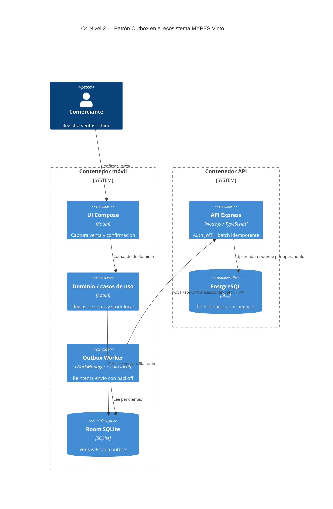

# INFORME DE PATRÓN ARQUITECTÓNICO

**Asignatura:** Arquitectura de Software (ARQ-643)  
**Patrón seleccionado:** **Outbox Pattern** (sincronización asíncrona / event-driven ligero)  
**Proyecto:** Asistente conversacional offline — MYPES Vinto  
**Equipo:** Eva Chino, Christian Gonzales, Marializ Mamani, Kevin Rocha, Luis Lazo  
**Repositorio:** https://github.com/bibi567-ch/asistente-ia-mypes-vinto  
**Rama:** `arq-tec`  
**Fecha:** noviembre 2026

---

## Sección I — Selección del patrón y contexto del problema

### Patrón

**Transactional Outbox** (también llamado outbox de mensajería local): las operaciones de negocio se persisten primero en el dispositivo (o en la misma transacción local) y se registran en una **cola outbox**; un proceso posterior envía esos eventos al backend cuando hay red, con **idempotencia** (`operationId` UUID).

### Problema concreto en el sistema

Los comerciantes de Vinto atienden **sin Internet estable**. Si el sistema solo escribiera en la API en el momento de la venta:

- se perderían ventas al caer la red,
- o se bloquearía la atención esperando al servidor.

Se necesita **acoplamiento temporal débil** entre la UI offline y la API de consolidación, sin duplicar ventas al reintentar.

### Por qué no otros patrones (en esta entrega)

| Patrón | Motivo de no elegirlo como foco único |
|---|---|
| API Gateway | No hay flota de microservicios que enrutar; hay un cliente y una API |
| gRPC entre muchos servicios | Complejidad innecesaria para un prototipo semestral de una API REST |
| Circuit Breaker solo | Complementario; no resuelve el almacenamiento offline de la venta |
| Message Broker (Kafka/Rabbit) en cloud | Infraestructura pesada para el alcance; el outbox local es el “broker” del dispositivo |

---

## Sección II — Justificación técnica y atributos de calidad

### Atributo de calidad principal

**Disponibilidad offline** (y en segundo plano **Confiabilidad** de no perder ni duplicar operaciones).

### Escenarios de calidad formales

| ID | Atributo | Fuente | Estímulo | Entorno | Artefacto | Respuesta esperada | Medida de calidad |
|---|---|---|---|---|---|---|---|
| **AQ-OUT-01** | Disponibilidad | Comerciante | Registra una venta sin Wi‑Fi ni datos | Mercado sin cobertura | App + Outbox local (Room) | La venta queda guardada localmente y encolada; la UI confirma éxito local | 100% de ventas confirmadas por el usuario persisten tras cerrar la app sin red |
| **AQ-OUT-02** | Confiabilidad / Integridad | Sistema de sync | Reenvío del mismo `operationId` tras timeout | Red intermitente | API batch + tabla de operaciones | Segunda entrega marcada como duplicada; no se crea venta doble | Idempotencia: mismo `operationId` → resultado `DUPLICADA` / sin doble efecto en BD |

### Por qué el Outbox satisface la medida

- **Frente a “solo API síncrona”:** sin outbox, el estímulo sin red falla y se pierde la operación.  
- **Frente a “reintento ciego sin idempotencia”:** se duplicarían ventas. El UUID de operación en el batch del backend (`POST /api/v1/transacciones/batch`) es el mecanismo de medida de AQ-OUT-02.

---

## Sección III — Diseño arquitectónico C4 Nivel 2



### Responsabilidades y protocolos

| Contenedor | Tecnología | Protocolo | Responsabilidad |
|---|---|---|---|
| UI Compose | Kotlin | in-process | Captura y confirmación visual |
| Room | SQLite | local | Fuente de verdad offline + outbox |
| Outbox Worker | WorkManager | HTTP JSON | Envío diferido |
| API Express | Node/TS | REST + JWT | Recepción idempotente |
| PostgreSQL | SQL | TCP local/Docker | Persistencia consolidada |

---

## Sección IV — Especificación del prototipo funcional

### Arquitectura de código relevante

**Backend (ya en repo):**

- `backend/src/routes/transacciones.routes.ts` — endpoint batch  
- `backend/src/sincronizacion/service/sincronizacion.service.ts` — lógica de aceptación/duplicado  
- Migraciones de operaciones de sync  

**Móvil (en repo, integración a demostrar):**

- Componentes Outbox / WorkManager / Retrofit en `mobile/`  
- Persistencia Room en `mobile/persistencia`

### Fragmento conceptual del patrón (backend — idempotencia)

```text
Para cada transacción del lote:
  1. Validar JWT y businessId del token
  2. Si operationId ya existe para ese negocio → estado DUPLICADA
  3. Si no existe → persistir efecto y marcar ACEPTADA
  4. Nunca aplicar dos veces el mismo operationId
```

### Guía de ejecución del prototipo (mínimo demostrable)

**Parte A — API (obligatoria en defensa ARQ)**

1. `docker compose up -d postgres`  
2. Configurar `backend/.env`, migrar, crear owner, `npm run dev`  
3. Login → obtener token  
4. `POST /api/v1/transacciones/batch` con un `operationId` fijo  
5. Repetir el **mismo** body → respuesta `DUPLICADA`  
6. Archivar request/response en `evidence/EV-SYNC-01`

**Parte B — Móvil (si el tiempo alcanza)**

1. Guardar venta en modo avión  
2. Verificar fila pendiente en outbox / UI  
3. Recuperar red y observar intento de sync  
4. No afirmar éxito sin captura y commit

### Estado de ejecución (honestidad)

| Parte | Ejecutable hoy | Qué falta para “100% patrón en vivo” |
|---|---|---|
| Idempotencia API batch | Sí (código + pruebas backend) | Evidencia archivada con pasos |
| Outbox extremo a extremo en teléfono | Parcial | Prueba física, URL no-emulador, token real |

---

## Sección V — Conclusiones, trade-offs y evaluación del patrón

### Resultados esperados al probar

- Sin red: la venta no se bloquea (disponibilidad).  
- Con reintento: no hay doble venta (confiabilidad).

### Trade-offs

| Beneficio | Costo |
|---|---|
| Operación offline realista para Vinto | Complejidad de cola, reintentos y estados |
| Idempotencia simple con UUID | El cliente **debe** generar y conservar `operationId` |
| API puede ser eventual | El stock “servidor” puede ir detrás del stock local; hay que comunicar “pendiente de sync” en UI |
| Sin broker cloud | Menos ops; a cambio, la lógica de reintento vive en el dispositivo |

### Conclusión

El **Outbox** es el patrón adecuado al driver **offline-first** del proyecto. La defensa debe mostrar **API idempotente** como prueba mínima del patrón y, si es posible, el encolado móvil. No presentar diagramas como si el sync en teléfono físico ya estuviera certificado sin evidencia.

---

## Anexo — Relación con SAD

- **SAD v1.1** (`docs/03_SAD_Arquitectura.md`): entrega histórica (incluye Spring en ADRs). **No se borra.**  
- **SAD v2 (pendiente de archivo propio):** debe citar este patrón Outbox, stack Node/Express/PostgreSQL + Android/Room, y los escenarios AQ-OUT-01/02.
