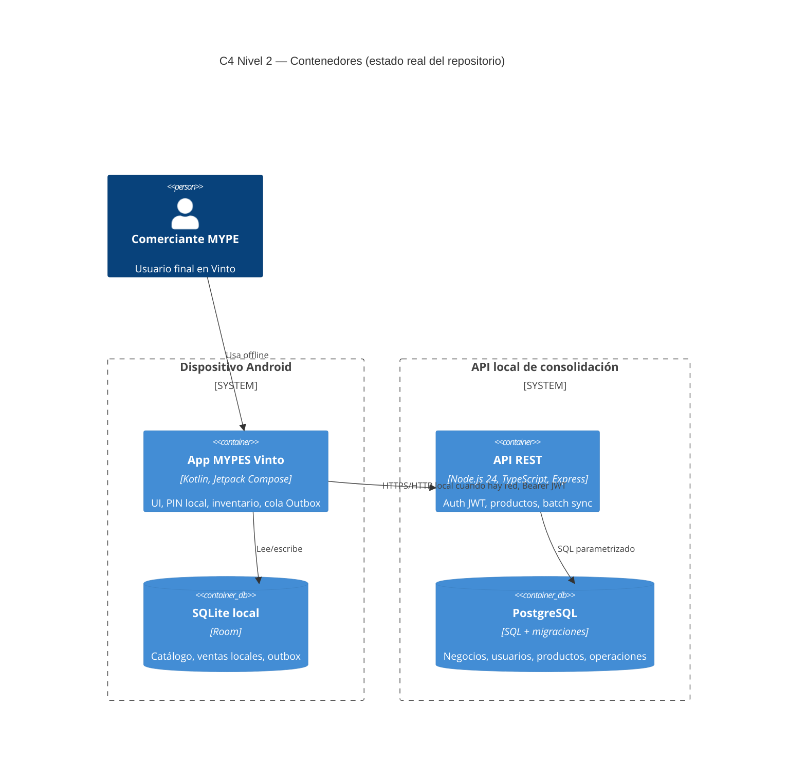
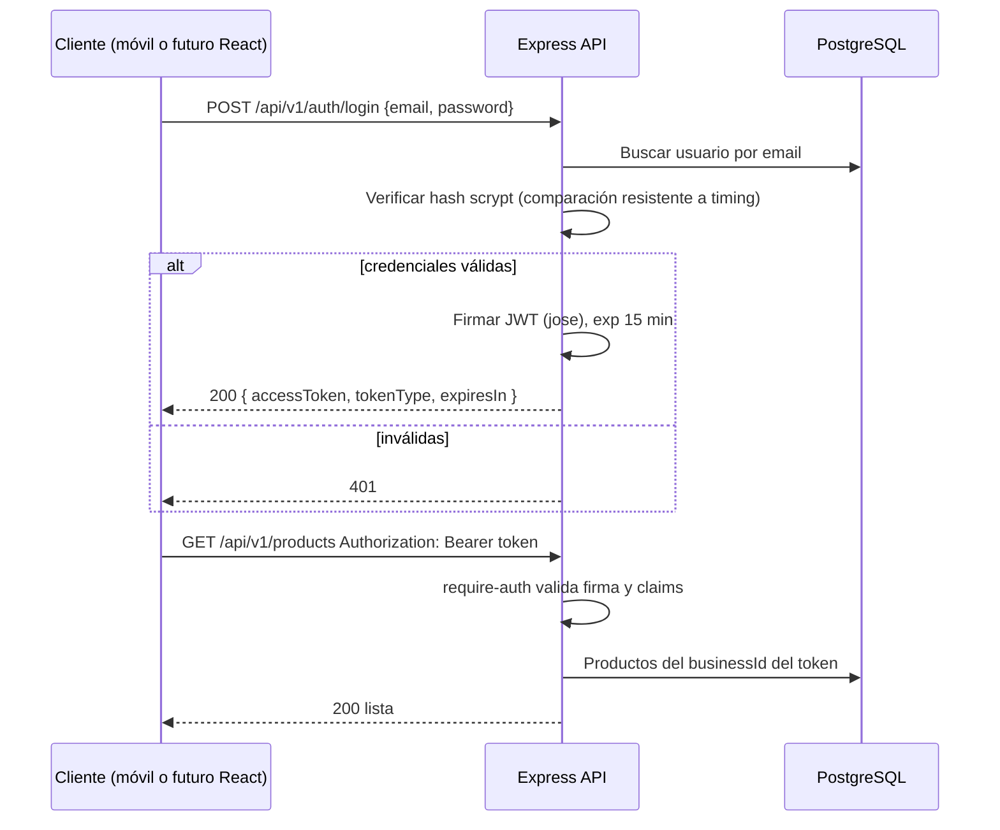

# INFORME TÉCNICO — Segunda Entrega Proyecto Integrador

**Asignatura:** Tecnologías en Internet (TEC-644)  
**Proyecto:** Asistente conversacional offline para MYPES del centro de Vinto  
**Equipo:** Eva Lizeth Chino Quispe, Christian Gonzales Mamani, Marializ Mamani Quispe, Kevin Jhonathan Rocha Rojas, Luis Gerardo Lazo Bustamante  
**Repositorio:** https://github.com/bibi567-ch/asistente-ia-mypes-vinto  
**Rama de trabajo documental:** `arq-tec`  
**Fecha:** noviembre 2026  
**Versión del informe:** 1.0 (borrador alineado a la especificación de 2ª entrega)

> **Aviso de honestidad académica.** Este informe describe lo **realmente implementado** y lo **pendiente** frente a la especificación oficial (React + Vite + Tailwind, MongoDB/Mongoose, Swagger, RBAC). No se afirma cumplimiento de criterios no presentes en el código.

---

## 1. Carátula e información general

| Campo | Valor |
|---|---|
| Título | Prototipo de asistente conversacional offline para registro de ventas y saldo local de existencias — MYPES Vinto |
| Asignatura | Tecnologías en Internet |
| Integrantes | Eva Chino, Christian Gonzales, Marializ Mamani, Kevin Rocha, Luis Lazo |
| Repositorio público | https://github.com/bibi567-ch/asistente-ia-mypes-vinto |
| Stack real en código | **Cliente:** Android Kotlin + Jetpack Compose + Room · **API:** Node.js 24 + TypeScript + Express · **BD central:** PostgreSQL |
| Stack exigido por la guía de 2ª entrega | React + Vite + Tailwind · Node + Express · MongoDB + Mongoose · JWT · RBAC · Swagger OpenAPI 3 |

**Enlace al repositorio (requisito excluyente):** debe verificarse que el repo sea **público** en Settings antes de la defensa.

---

## 2. Resumen ejecutivo y alcance

### Qué se entrega en esta fase

Sistema orientado a comerciantes de MYPES en Vinto que necesita operar **sin red** en el momento de la atención. El cliente móvil guarda productos y prepara el envío diferido; la API local consolida datos cuando hay conexión.

### Alcance alcanzado (código)

| Componente | Estado |
|---|---|
| API Node/Express/TypeScript | Login JWT, cambio de contraseña, catálogo de productos por negocio, batch de transacciones idempotente, health |
| PostgreSQL + migraciones | Esquema de negocios, usuarios, productos, sync_operations |
| App Android (Kotlin/Compose/Room) | Login PIN local, onboarding, dashboard, inventario; componentes de outbox/sync presentes |
| Docker Compose | PostgreSQL local para desarrollo |

### Fuera de alcance / no implementado aún (frente a la guía TEC)

- SPA **React + Vite + Tailwind**
- **MongoDB / Mongoose**
- **Swagger UI / OpenAPI 3** interactivo
- **RBAC** multi-rol completo (hoy: propietario autenticado por JWT; sin roles admin/vendedor formalizados en middleware)
- Despliegue cloud, HTTPS/TLS en producción
- Integración móvil–API verificada extremo a extremo en teléfono físico

### Justificación de PostgreSQL (no MongoDB)

El dominio relaciona **negocios → usuarios → productos → operaciones de sincronización** con restricciones de unicidad, aislamiento por negocio y procesamiento transaccional. PostgreSQL permite claves foráneas, transacciones ACID y migraciones versionadas ya presentes en `backend/db/migrations`.

**PostgreSQL no acredita el criterio curricular MongoDB/Mongoose.** El equipo debe:

1. Presentar esta justificación al docente, y  
2. Si se exige Mongo: entregar una **práctica didáctica separada** (CRUD Mongoose mínimo) **sin** afirmar que el producto productivo usa MongoDB.

### Justificación de Android frente a React

El problema de Vinto exige **offline-first en dispositivos de gama baja**. Kotlin nativo + Room cumple disponibilidad sin red (RNF del proyecto). React web no opera offline de forma nativa igual que una app con SQLite local.

**La guía de 2ª entrega exige React.** Opciones:

- **A (preferida si el docente acepta):** mantener Android como cliente del producto e implementar un **panel web mínimo React** solo para administración/consulta (cumple stack de la guía sin abandonar el offline móvil).
- **B:** acuerdo escrito del docente de evaluar Android Compose en lugar de React para esta entrega.

Hasta no haber acuerdo, el criterio “Frontend React” de la rúbrica queda en **brecha**.

---

## 3. Trazabilidad de requisitos

### 3.1 Matriz RF → implementación real (no inventar componentes React)

La especificación de ejemplo usa `<Login />` React. Aquí se mapea a lo **existente**:

| Código RF | Descripción | Frontend real | Endpoint / servicio backend | Estado |
|---|---|---|---|---|
| RF-001 / login propietario | Autenticación | App: PIN local; API: login email/password | `POST /api/v1/auth/login` | Parcial (API sí; registro público no) |
| RF-002 | PIN offline | `mobile/` login local | N/A (local) | En código; evidencia a archivar |
| RF-003 | Perfil / rubro | Onboarding móvil | — | Parcial |
| RF-009 / ventas | Registrar venta | Modelos móviles + batch | `POST /api/v1/transacciones/batch` | Backend batch sí; flujo UI venta a completar |
| RF-013 / saldo | Descontar stock local | Room / dominio móvil | Stock permanece en móvil (MVP API) | Diseño; verificar UI |
| RF-016 | Alta de producto | Inventario móvil + API | `POST /api/v1/products` | API sí; móvil reportado con producto de prueba |
| RF-017 | Consultar saldo | Inventario / consultas | `GET /api/v1/products` | Parcial |
| RF-018 / Outbox | Encolar offline | Outbox móvil | Tabla `sync_operations` + batch | Patrón en diseño/código parcial |
| RF-019 | Envío al recuperar red | WorkManager / sync | Batch autenticado JWT | Pendiente prueba en dispositivo físico |
| Documentación API | — | — | **Swagger: pendiente** | Brecha rúbrica TEC |

### 3.2 RNF — validación

| RNF | Exigencia guía / proyecto | Situación |
|---|---|---|
| Rendimiento backend | Consultas estándar | API local; métricas formales **pendientes** |
| Frontend | Vite + Tailwind responsive | **No aplica:** cliente Android; si se agrega React, medir LCP/carga |
| Seguridad | Bcrypt/scrypt, JWT, expiración | **scrypt** + JWT (jose), expiración 15 min; **sin** rate-limit ni RBAC rico |
| Usabilidad | UX 1ª entrega | Figma + Compose; contraste WCAG a verificar en capturas |

---

## 4. Arquitectura del sistema

### 4.1 C4 Nivel 2 (Contenedores) — arquitectura real



> Si se construye el front React exigido por la guía, se añadirá un contenedor **Web SPA (React + Vite + Tailwind)** que consuma la misma API.

### 4.2 Secuencia de autenticación JWT (API actual)



---

## 5. Diseños de persistencia

### 5.1 PostgreSQL (productivo del backend)

Colecciones/tablas principales (migraciones en `backend/db/migrations/`):

- `businesses` — negocio
- `users` — propietario (email, hash de contraseña)
- `products` — catálogo aislado por negocio
- operaciones de sincronización / batch (idempotencia por `operationId`)

Índices y restricciones: unicidad de producto por negocio; consultas parametrizadas (sin concatenar SQL).

### 5.2 MongoDB / Mongoose — posición del equipo

**No se usa en el producto.** Justificación técnica: dominio relacional con integridad referencial y transacciones de venta/sync.

**Plan académico:** si el docente exige el criterio de la rúbrica (20% MongoDB):

1. Práctica separada `labs/mongo-practica/` con un modelo Mongoose de ejemplo (p. ej. log de eventos), o  
2. Acuerdo escrito de aceptar PostgreSQL con esta justificación.

No se modificará el discurso oral para decir “usamos MongoDB”.

### 5.3 Persistencia local móvil

Room/SQLite en el dispositivo: fuente de verdad offline; Outbox para reintentos.

---

## 6. Especificación de endpoints y API REST

| Método | Ruta | Auth | Descripción | Roles actuales |
|---|---|---|---|---|
| GET | `/api/v1/health` | No | Salud del servicio | público |
| POST | `/api/v1/auth/login` | No | Emite JWT | propietario |
| POST | `/api/v1/auth/change-password` | Bearer | Cambia contraseña | propietario autenticado |
| GET | `/api/v1/products` | Bearer | Lista productos del negocio del token | propietario |
| POST | `/api/v1/products` | Bearer | Crea producto | propietario |
| POST | `/api/v1/transacciones/batch` | Bearer | Lote idempotente offline | propietario |
| GET | `/api/v1/products/sync` | Bearer | Delta de productos | propietario |

**Swagger OpenAPI 3:** **pendiente de implementar** (`/api-docs`). Responsable: Marializ + apoyo Luis.  
**RBAC:** hoy un rol efectivo (propietario del negocio en claims). Ampliar middleware de roles si la rúbrica exige admin/operador explícitos.

Códigos de estado usados: 200, 401, 409 (duplicados), y rechazos de batch (`ACEPTADA` / `DUPLICADA` / `CONFLICTO` / `RECHAZADA`).

---

## 7. Configuración de entorno y variables

Archivo de referencia: `backend/.env.example` (nunca subir `.env` real).

Variables típicas:

| Variable | Uso |
|---|---|
| `DATABASE_URL` / host PostgreSQL | Conexión BD |
| `JWT_SECRET` | Firma de tokens (generar aleatorio local) |
| `PORT` | Puerto API (p. ej. 3000) |

Prohibido en Git: contraseñas, tokens, cadenas Atlas, datos de comerciantes reales.

---

## 8. Manual de ejecución y pruebas

### Requisitos previos

- Node.js 24.x, npm, Docker Desktop (Compose)
- (Opcional) Android Studio para `mobile/`

### Backend

```powershell
docker compose up -d postgres
Copy-Item backend/.env.example backend/.env
# Generar JWT_SECRET y añadirlo a backend/.env
Set-Location backend
npm ci
npm run db:migrate
npm run admin:create-owner -- "MYPE de prueba" "propietario@example.test"
npm run dev
```

Comprobar: http://127.0.0.1:3000/api/v1/health → `ok`

Pruebas:

```powershell
npm test
npm run test:integration
```

### Móvil

Abrir `mobile/` en Android Studio → sincronizar Gradle → run debug.  
La URL `10.0.2.2` es del emulador; en teléfono físico configurar la IP de la máquina de desarrollo.

### Checklist de prueba mínima antes de defensa TEC

- [ ] Health 200
- [ ] Login → token
- [ ] GET/POST products con Bearer
- [ ] Batch con `operationId` duplicado → `DUPLICADA`
- [ ] Sin token → 401 en rutas protegidas
- [ ] Capturas anonimizadas en `evidence/`

---

## 9. Conclusiones y trabajo futuro

### Conclusiones

1. El backend Node/Express/PostgreSQL cubre el **núcleo REST + JWT** alineado a parte de la guía TEC.  
2. Los criterios **React**, **MongoDB**, **Swagger** y **RBAC rico** están **abiertos** y deben resolverse por implementación mínima o **acuerdo docente documentado**.  
3. El valor del proyecto (offline MYPES) no se sustituye por un CRUD web genérico; si se agrega React, debe ser **complemento** (panel), no reemplazo del cliente móvil.

### Trabajo futuro (priorizado para la rúbrica)

1. Swagger OpenAPI 3 en la API.  
2. Decisión formal Mongo (práctica separada vs. cambio de stack).  
3. Front React mínimo **o** carta del docente.  
4. RBAC explícito en middleware si se evalúa ese 20% de la rúbrica.  
5. Evidencias de integración móvil–API en dispositivo físico.

---

## Anexo A — Autoevaluación orientativa vs rúbrica TEC (100 pts)

| Criterio | Peso | Autoevaluación honesta | Acción |
|---|---:|---|---|
| 1. Repo GitHub y estructura | 15% | Bueno si repo público + README; falta `client/` React | Publicar repo; documentar `mobile/`+`backend/` |
| 2. JWT y RBAC | 20% | JWT/scrypt funcionales; RBAC básico | Ampliar roles o declarar límite |
| 3. MongoDB/Mongoose | 20% | **No cumple** si se exige literal | Justificación + práctica o acuerdo docente |
| 4. Arquitectura y diagramas | 15% | C4 y secuencia en este informe | Alinear capturas al código |
| 5. API REST y Swagger | 15% | API sí; **Swagger no** | Implementar `/api-docs` |
| 6. Calidad del informe | 15% | Estructura 9 secciones presente | Completar evidencias y fechas |

**No usar esta autoevaluación como nota oficial.**
