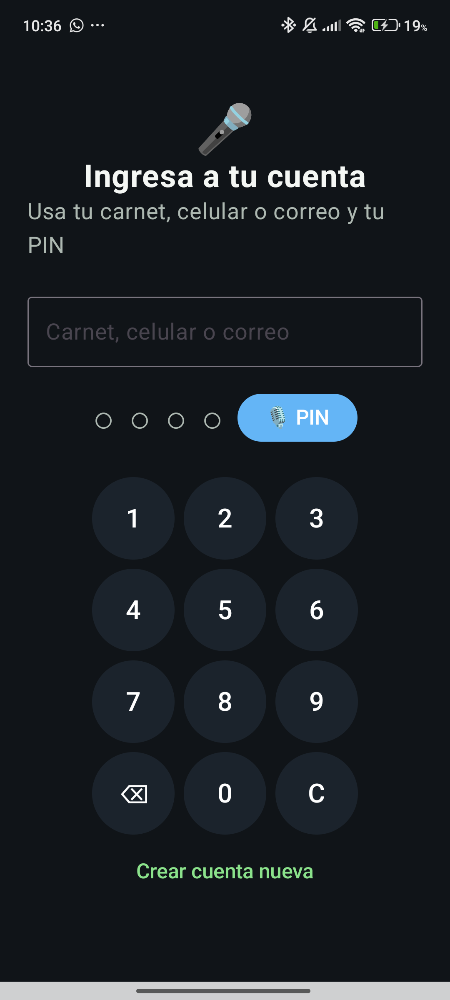

# Evidencia visual disponible y pruebas pendientes

La captura existente demuestra que la pantalla inicial de acceso se visualizó; no demuestra que el PIN se validó, que la sesión local se abrió ni que el usuario se registró correctamente.

Siguen pendientes las capturas de una prueba funcional de login y de registro confirmado contra PostgreSQL. No marcar esos escenarios aprobados hasta ejecutar los pasos y adjuntar evidencia anonimizada.

Archivos previstos:

- `login_exitoso.png`
- `registro_en_postgres.png`
